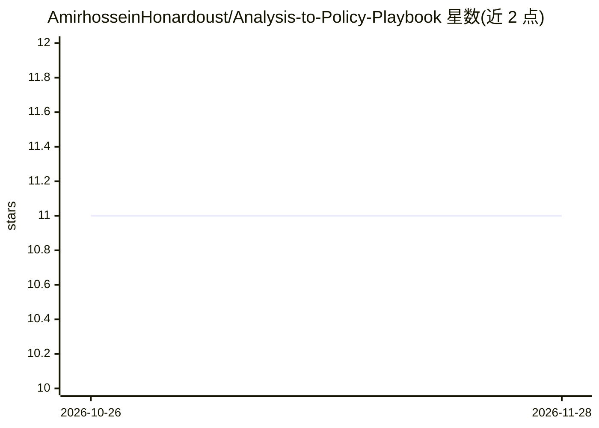

# AmirhosseinHonardoust/Analysis-to-Policy-Playbook

⭐ 11 · MIT · 推送 2026-06-04 · [GitHub](https://github.com/AmirhosseinHonardoust/Analysis-to-Policy-Playbook) · 个人维护

**面向数据从业者的方法论文：把分析结果转化为可辩护的决策规则**

一篇方法论文章，提供从数据分析到决策规则的六步框架（Policy Ladder）：定义决策与行动单元、列出错误成本风险表、选择决策变量、以阈值/区间/控制限/队列感知形式写成规则、产出 Policy Card 文档模板、补充漂移监控与更新触发条件。附带三个小型案例（检测器弃权策略、库存补货规则、公平感知基准）和项目写法清单。无代码包，仅含 Markdown 模板片段。

## 筛选速览

| 维度 | 判定 | 备注 |
|---|---|---|
| AI 角色 | `ai-knowledge` | 知识聚合/清单类 |
| 许可风险 | `permissive` | MIT |
| 部署形态 | `None` |  |
| 模型依赖 | — | README 未给出锁定关系 |
| 硬件要求 | — | 无带数字的原话,不猜 |
| 安装摩擦 | `low` | 无编译、无系统依赖或容器化 |
| 成熟度 | — | 结构信号不足 |

## 能力要点

- 六步 Policy Ladder：从分析到可执行规则的转化流程
- Policy Card 文档模板（Markdown 格式）
- 四种规则形式：阈值、区间、控制限、队列感知
- 监控触发条件清单（输入/输出/结果/容量漂移）

## 适用场景

- 把模型输出规则化为自动决策与人工审核的分流策略
- 为数据产品写出带错误成本与监控的决策文档
- 设计带不确定性标注和公平性提示的基准比较

## 场景标签

 · 领域:数据科学方法论/决策工程

## 证据(README 行号)

> L1: # From Analysis to Policy: Turning Insights into Rules You Can Defend
> L19: This article is a practical framework for that conversion, usable whether you’re building:
> L56: ## The Policy Ladder: 6 steps from analysis → rules

## 星数曲线

2026-10-26 11 → 2026-11-28 11（+0）

---
*卡片 v1 · prompt 1.4 · 生成 2026-11-19 · 置信度 high · 依据 README sha `155e9a61e580` · [字段定义](../../DATASET.md)*
