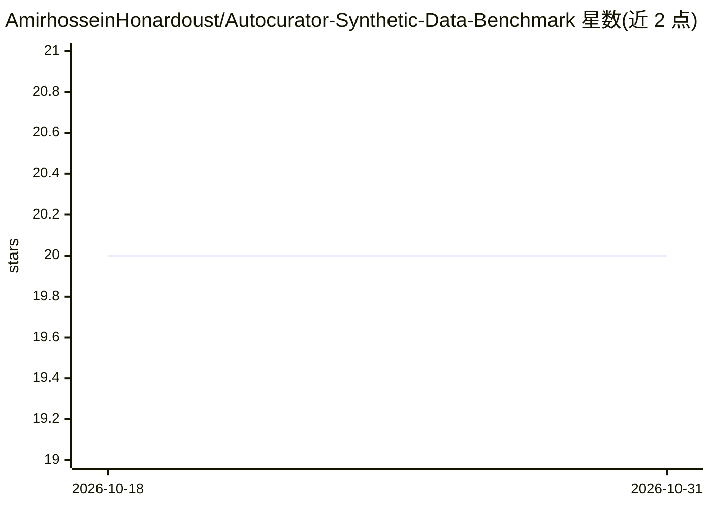

# AmirhosseinHonardoust/Autocurator-Synthetic-Data-Benchmark

⭐ 20 · Python · MIT · 推送 2026-07-26 · [GitHub](https://github.com/AmirhosseinHonardoust/Autocurator-Synthetic-Data-Benchmark) · 个人维护

**合成表格数据评测工具：度量保真、覆盖、隐私与效用**

面向合成表格数据的评测与诊断工具包（Python CLI），读取真实与合成 CSV，经 schema 对齐与共享特征空间后计算四类指标：保真（JSD/KS/Wasserstein/相关性距离）、覆盖（PRDC）、隐私（最近邻距离与成员推断 AUC，含可选 holdout 攻击）、效用（TSTR/TRTS）。输出 metrics.json 与含 PCA、分布、相关性图的 HTML 报告，支持 YAML 配置。不生成合成数据、不构成隐私认证；指标在 CI 中与独立参考实现对齐至 1e-9。

## 筛选速览

| 维度 | 判定 | 备注 |
|---|---|---|
| AI 角色 | `ai-ecosystem` | LLM/agent 周边工具 |
| 许可风险 | `permissive` | MIT |
| 部署形态 | `library` | 以包/库形式分发 |
| 模型依赖 | — | README 未给出锁定关系 |
| 硬件要求 | — | 无带数字的原话,不猜 |
| 安装摩擦 | `low` | 无编译、无系统依赖或容器化 |
| 成熟度 | — | 结构信号不足 |

## 能力要点

- 四轴指标：保真/覆盖(PRDC)/隐私(MIA)/效用(TSTR-TRTS)
- 可选 holdout 成员推断攻击（AUC 0.5 = 无泄漏）
- metrics.json 与含 PCA/分布/相关性图的 HTML 报告
- 指标在 CI 中与独立参考实现校验（1e-9），附生成器敏感性基准

## 适用场景

- 发布或采购合成数据集前做多维度质量评测
- 检测合成数据是否近乎复制真实记录（隐私泄漏）
- 验证用合成数据训练的模型在真实数据上的效用
- 为 VAE/GAN/Copula/Diffusion 生成的数据出对比报告

## 场景标签

`模型评测` · 领域:评测与运维

## 证据(README 行号)

> L10: A modular evaluation toolkit that benchmarks **synthetic tabular data** against **real data** across four axes — **
> L12: > **Important:** Autocurator is an **evaluation and diagnostic tool**, not a certification of privacy or safety.

## 星数曲线

2026-10-18 20 → 2026-10-31 20（+0）

---
*卡片 v1 · prompt 1.4 · 生成 2026-10-28 · 置信度 high · 依据 README sha `e6c2c927a7d0` · [字段定义](../../DATASET.md)*
