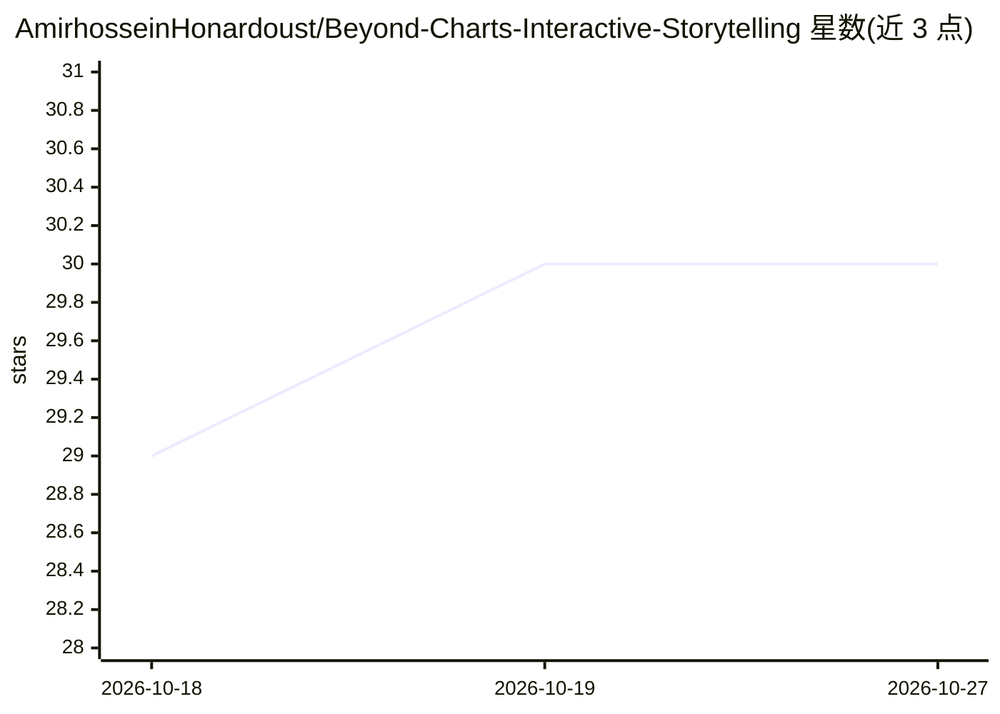

# AmirhosseinHonardoust/Beyond-Charts-Interactive-Storytelling

⭐ 30 · MIT · 推送 2025-11-02 · [GitHub](https://github.com/AmirhosseinHonardoust/Beyond-Charts-Interactive-Storytelling) · 个人维护

**Python/Streamlit/Plotly 交互式数据叙事仪表盘教程与代码**

一篇图文教程配套代码：基于合成电商数据集（4,000+ 订单、1,600+ 客户）演示如何用 Streamlit 与 Plotly 构建交互式仪表盘，内容覆盖环境安装、侧边栏过滤、KPI 快照、时间序列、类别与地理分布（treemap）、RFM 客户分层与同期群留存分析。面向数据分析师与数据科学家，含部署方式（Streamlit Cloud、Render、Docker 等）。可选扩展提及 Prophet 预测与 LLM 生成摘要，非产品内实现。

## 筛选速览

| 维度 | 判定 | 备注 |
|---|---|---|
| AI 角色 | `ai-knowledge` | 知识聚合/清单类 |
| 许可风险 | `permissive` | MIT |
| 部署形态 | `library` | 以包/库形式分发 |
| 模型依赖 | — | README 未给出锁定关系 |
| 硬件要求 | — | 无带数字的原话,不猜 |
| 安装摩擦 | `low` | 无编译、无系统依赖或容器化 |
| 成熟度 | — | 结构信号不足 |

## 能力要点

- 以叙事结构组织仪表盘：概览→趋势→细分→行为→结论
- RFM 客户分层与同期群留存分析代码示例
- 合成电商数据集（4,000+ 订单、10 国、5 品类）
- 列出 Streamlit Cloud/Render/Docker 等部署途径

## 适用场景

- 学习用 Streamlit+Plotly 构建交互式 BI 仪表盘
- 复用 RFM 分层与同期群留存分析代码模板
- 参考仪表盘的叙事结构与部署方式

## 场景标签

`教程课程` · 领域:学习与行业

## 证据(README 行号)

> L3: ## Introduction, Why Data Storytelling Needs to Evolve
> L14: In this article, I’ll walk you through how I built a **data storytelling dashboard**, a full-scale interactive app 
> L31: Unlike Power BI or Tableau, you control the logic end-to-end.

## 星数曲线

2026-10-18 29 → 2026-10-27 30（+1）

---
*卡片 v1 · prompt 1.4 · 生成 2026-10-26 · 置信度 high · 依据 README sha `fa9f51cb0d55` · [字段定义](../../DATASET.md)*
