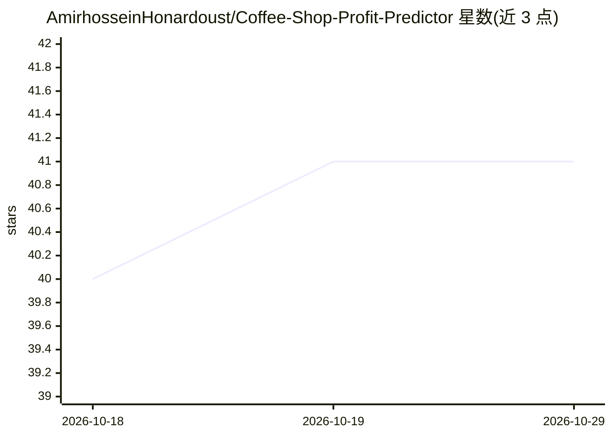

# AmirhosseinHonardoust/Coffee-Shop-Profit-Predictor

⭐ 41 · Python · MIT · 推送 2026-09-06 · [GitHub](https://github.com/AmirhosseinHonardoust/Coffee-Shop-Profit-Predictor) · 个人维护

**用 SQL 特征工程与回归模型预测咖啡店选址月利润的 Python CLI 项目**

端到端回归项目：将 CSV 选址数据载入 SQLite，通过可复用 SQL 视图构建特征（训练与候选站点同一变换），比较多种回归模型（线性/Ridge/ElasticNet/随机森林/梯度提升）并做交叉验证与超参调优，在留出集上评估后对候选店址输出月利润点估计、split-conformal 预测区间、外推风险带与业务可读的正负驱动因素。以可安装包形式提供 coffee-build-db/coffee-train/coffee-score 等命令。README 声明其为选址决策支持演示，非生产级财务预测系统；不含人工与销货成本、季节性、实时市场数据。捆绑数据由带种子的生成器合成。

## 筛选速览

| 维度 | 判定 | 备注 |
|---|---|---|
| AI 角色 | `ai-native` | 本体是模型或模型工具 |
| 许可风险 | `permissive` | MIT |
| 部署形态 | `library` | 以包/库形式分发 |
| 模型依赖 | — | README 未给出锁定关系 |
| 硬件要求 | — | 无带数字的原话,不猜 |
| 安装摩擦 | `low` | 无编译、无系统依赖或容器化 |
| 成熟度 | — | 结构信号不足 |

## 能力要点

- SQLite SQL 视图特征工程，训练与候选站点变换一致（无 train/serve skew）
- 多模型交叉验证对比 + 均值基线 + 留出集评估
- split-conformal 预测区间与外推风险带（profile distance）
- 候选排名输出业务可读的正/负驱动因素解释

## 适用场景

- 按预测月利润对候选咖啡店店址排序并查看风险带
- 学习诚实的回归工作流（基线对比、留出集、预测区间）
- 作为数据工程 + 机器学习作品集项目展示

## 场景标签

 · 领域:零售分析/机器学习

## 证据(README 行号)

> L11: A machine learning project that turns coffee-shop location data into a **monthly-profit estimate**, using **SQL fea
> L44: - Score new candidate locations and rank them by predicted profit

## 星数曲线

2026-10-18 40 → 2026-10-29 41（+1）

---
*卡片 v1 · prompt 1.4 · 生成 2026-10-25 · 置信度 high · 依据 README sha `a502bf9f1fb2` · [字段定义](../../DATASET.md)*
