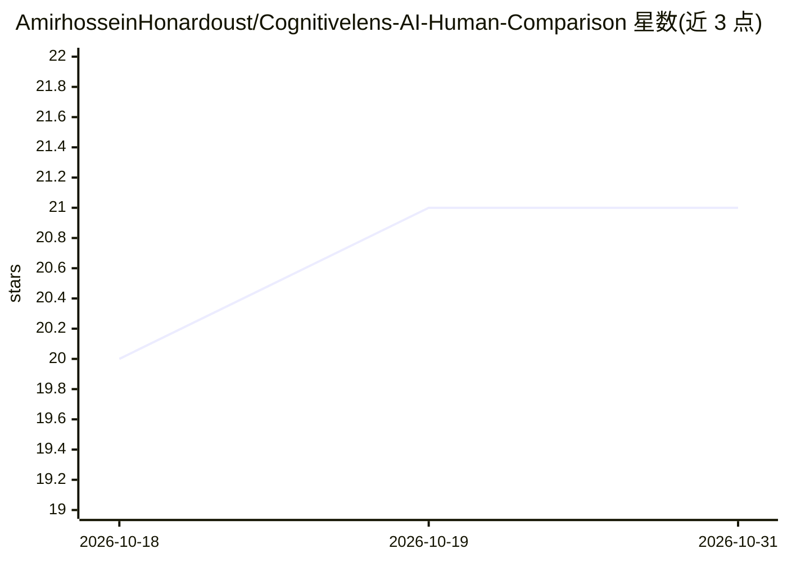

# AmirhosseinHonardoust/Cognitivelens-AI-Human-Comparison

⭐ 21 · Python · MIT · 推送 2025-11-05 · [GitHub](https://github.com/AmirhosseinHonardoust/Cognitivelens-AI-Human-Comparison) · 个人维护

**对比人类与 AI 决策一致性的公平性与校准分析工具**

基于 Python/Streamlit/Plotly 构建的分析应用：上传 CSV 数据（含 human_label、y_true 与敏感属性列）后，用 Logistic Regression、Random Forest 或 XGBoost 训练模型，计算人类与 AI 判定的一致率、Cohen's κ、AUC、Brier 分数，并按性别、地区、收入等子群体给出公平性差异分析。支持概率分布、ROC 曲线、混淆矩阵可视化，数值型公平性属性自动按分位数分箱，可导出 .joblib 模型与评估结果 CSV。设计上预留 SHAP、LIME 等可解释性工作流集成。面向数据科学家与 AI 从业者，从源码经 git clone 与 pip 安装依赖后以 streamlit run 启动。

## 筛选速览

| 维度 | 判定 | 备注 |
|---|---|---|
| AI 角色 | `ai-ecosystem` | LLM/agent 周边工具 |
| 许可风险 | `permissive` | MIT |
| 部署形态 | `library` | 以包/库形式分发 |
| 模型依赖 | — | README 未给出锁定关系 |
| 硬件要求 | — | 无带数字的原话,不猜 |
| 安装摩擦 | `low` | 无编译、无系统依赖或容器化 |
| 成熟度 | — | 结构信号不足 |

## 能力要点

- 人类与 AI 决定一致率、Cohen's κ 等对齐度量
- 按人口统计子群体的公平性差异审计（数值属性自动分位分箱）
- Brier 分数与校准曲线等置信度分析
- Survey 模式追加人工标注样本到本地数据集

## 适用场景

- 对比贷款审批模型与人工审核员的公平性与一致性
- 评估放射科医生与 AI 影像分类结果的一致性
- 检测自动简历筛选相对人工评估的子群体偏差
- 将伦理 AI 分析结果导出为可视化报告用于汇报

## 场景标签

`模型评测` `数据分析` · 领域:效率与自动化

## 证据(README 行号)

> L24: - **Human vs AI Agreement Metrics**
> L72: 4. **Evaluation**

## 星数曲线

2026-10-18 20 → 2026-10-31 21（+1）

---
*卡片 v1 · prompt 1.4 · 生成 2026-10-28 · 置信度 mid · 依据 README sha `3076cf8013db` · [字段定义](../../DATASET.md)*
