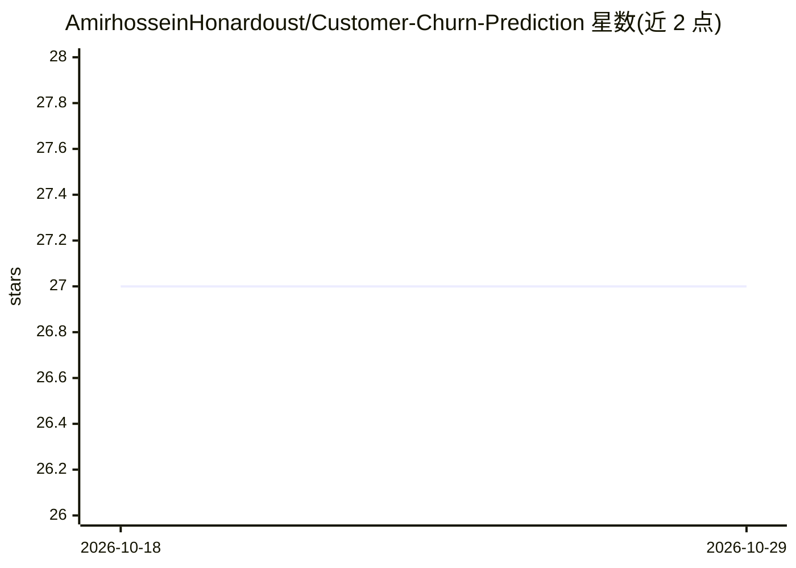

# AmirhosseinHonardoust/Customer-Churn-Prediction

⭐ 27 · Python · MIT · 推送 2026-07-07 · [GitHub](https://github.com/AmirhosseinHonardoust/Customer-Churn-Prediction) · 个人维护

**客户流失预测工作流演示：训练、调阈值、批量打分**

基于 Python/scikit-learn 的端到端客户流失建模工作流：生成合成数据或获取 IBM Telco 公开数据集，经 schema 校验后训练 Logistic Regression、Random Forest、Gradient Boosting 三种模型，按验证集 PR-AUC 选模型，面向召回做 F2 阈值调优，可选保序校准概率，输出 ROC/PR/混淆矩阵/校准/置换重要性图与指标文件，并提供批量打分 CLI。README 明确声明这是作品集与研究演示，不用于真实留存决策；不含实时 API、监控与公平性分析。以源码方式提供，含单元测试与 GitHub Actions CI（Python 3.10-3.12）。

## 筛选速览

| 维度 | 判定 | 备注 |
|---|---|---|
| AI 角色 | `ai-native` | 本体是模型或模型工具 |
| 许可风险 | `permissive` | MIT |
| 部署形态 | `library` | 以包/库形式分发 |
| 模型依赖 | — | README 未给出锁定关系 |
| 硬件要求 | — | 无带数字的原话,不猜 |
| 安装摩擦 | `low` | 无编译、无系统依赖或容器化 |
| 成熟度 | — | 结构信号不足 |

## 能力要点

- 合成数据生成器与 IBM Telco 数据加载器，pipeline 对任意含二元 churn 目标的 CSV 通用
- 按 PR-AUC 选模型 + F2 召回导向阈值调优（含精度下限）
- 可选保序校准与 Brier 分数评估概率质量
- 批量预测 CLI 复用训练时的特征 schema 与调优阈值

## 适用场景

- 学习一条面向决策支持的流失建模流程（选型、调阈值、校准、解释）
- 在自有含 churn 标签的 CSV 上复现完整训练与评估
- 用训练好的 pipeline 对新客户批量输出流失概率

## 场景标签

 · 领域:数据科学/客户分析

## 证据(README 行号)

> L9: A production-minded customer-churn workflow for turning behavioural signals into **calibrated churn probabilities**,
> L38: - Train and tune Logistic Regression, Random Forest, and Gradient Boosting

## 星数曲线

2026-10-18 27 → 2026-10-29 27（+0）

---
*卡片 v1 · prompt 1.4 · 生成 2026-10-26 · 置信度 mid · 依据 README sha `b402f5f6a088` · [字段定义](../../DATASET.md)*
