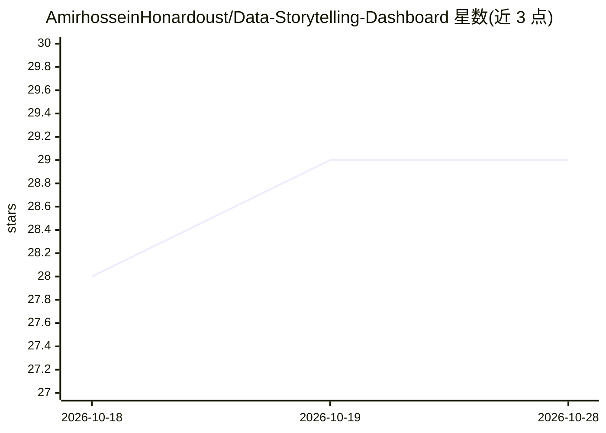

# AmirhosseinHonardoust/Data-Storytelling-Dashboard

⭐ 29 · Python · MIT · 推送 2025-11-02 · [GitHub](https://github.com/AmirhosseinHonardoust/Data-Storytelling-Dashboard) · 个人维护

**电商分析交互式数据叙事仪表盘，含 KPI/留存/RFM 分群**

基于 Python、Streamlit 与 Plotly 构建的电商分析仪表盘：读取订单数据后生成收入/利润/订单量等 KPI 卡片、月度趋势图、渠道收入占比、国家→城市 treemap 地理分布、同期群留存分析，并用 Scikit-Learn 做 RFM 客户分群（Champions/Active/New-Cold）。默认使用 4,000+ 订单、1,600+ 客户的两年期合成数据集，也可通过 ORDERS_CSV 环境变量接入自有数据（需满足指定字段结构）。面向分析师与数据科学家，本地 streamlit 命令运行，Prophet/ARIMA 预测列为扩展方向。

## 筛选速览

| 维度 | 判定 | 备注 |
|---|---|---|
| AI 角色 | `ai-enhanced` | 去掉 AI 部分产品仍成立 |
| 许可风险 | `permissive` | MIT |
| 部署形态 | `library` | 以包/库形式分发 |
| 模型依赖 | — | README 未给出锁定关系 |
| 硬件要求 | — | 无带数字的原话,不猜 |
| 安装摩擦 | `low` | 无编译、无系统依赖或容器化 |
| 成熟度 | — | 结构信号不足 |

## 能力要点

- KPI 汇总、月度趋势、渠道与地理分布的可视化
- 同期群留存分析与基于 Scikit-Learn 的 RFM 客户分群
- 支持通过 ORDERS_CSV 环境变量替换为自有订单数据集
- 数据规模：4,000+ 订单、1,600+ 客户、10+ 国家的合成数据

## 适用场景

- 作为分析师查看电商销售、利润与渠道表现的交互式看板
- 做客户留存与 RFM 分群分析，识别高价值客户
- 学习如何用 Streamlit 与 Plotly 构建数据叙事仪表盘

## 场景标签

`数据分析` · 领域:效率与自动化

## 证据(README 行号)

> L3: An interactive **data visualization and analytics dashboard** that transforms raw e-commerce data into **actionable 
> L39: **RFM Segmentation** | Classify customers into “Champions”, “Active”, and “New/Cold”
> L87: |**Scikit-Learn**|RFM modeling & segmentation|

## 星数曲线

2026-10-18 28 → 2026-10-28 29（+1）

---
*卡片 v1 · prompt 1.4 · 生成 2026-10-26 · 置信度 high · 依据 README sha `7b8f30611640` · [字段定义](../../DATASET.md)*
