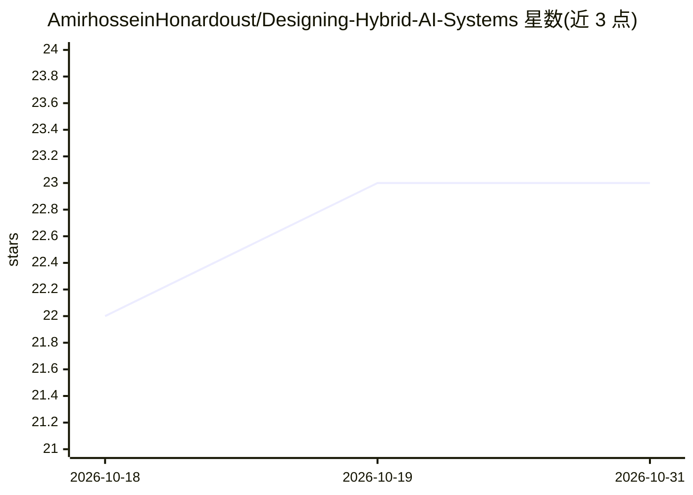

# AmirhosseinHonardoust/Designing-Hybrid-AI-Systems

⭐ 23 · MIT · 推送 2026-07-03 · [GitHub](https://github.com/AmirhosseinHonardoust/Designing-Hybrid-AI-Systems) · 个人维护

**Graph-Powered RAG 引擎的设计蓝图与工程经验文章**

一篇设计文章与参考架构：讲解如何将向量检索（FAISS）、知识图谱（NetworkX/Neo4j）与 RAG 结合，构建可引用、可推理、可解释答案的混合检索系统。内容覆盖摄取与分块、图构建与 PageRank、混合评分归一化、答案溯源与服务层（FastAPI/Streamlit）设计，并给出评测模板与工程经验。明确声明这是蓝图而非已交付库，代码为示例伪码，可运行实现列入 Roadmap。面向构建企业问答、医疗法律溯源等场景的 AI 工程师。

## 筛选速览

| 维度 | 判定 | 备注 |
|---|---|---|
| AI 角色 | `ai-knowledge` | 知识聚合/清单类 |
| 许可风险 | `permissive` | MIT |
| 部署形态 | `None` |  |
| 模型依赖 | — | README 未给出锁定关系 |
| 硬件要求 | — | 无带数字的原话,不猜 |
| 安装摩擦 | `low` | 无编译、无系统依赖或容器化 |
| 成熟度 | `idea` | |

## 能力要点

- 向量+图谱双层检索：向量召回候选、图谱扩展重排并输出解释路径
- 混合评分公式及三信号归一化处理（相似度/概念重叠/PageRank）
- 抽取式（无 LLM）与生成式两种答案组成模式，均附来源与'为什么'溯源
- 标注为设计蓝图：参考实现尚未交付，代码为示例伪码

## 适用场景

- 参考架构设计自己的 Graph-RAG 混合检索系统
- 为需要溯源与可解释性的问答系统（企业知识库、医疗法律）做方案调研
- 学习混合检索评测指标（Recall@k、grounding rate、延迟）的消融方法

## 场景标签

`RAG` `知识图谱` `教程课程` · 领域:知识与检索

## 证据(README 行号)

> L11: > **What this repository is.** This is a **design article and reference architecture** — a detailed blueprint disti
> L4: *A design blueprint and set of engineering lessons for building a Graph-Powered RAG engine — systems that don't just

## 星数曲线

2026-10-18 22 → 2026-10-31 23（+1）

---
*卡片 v1 · prompt 1.4 · 生成 2026-10-27 · 置信度 high · 依据 README sha `c978ea45b688` · [字段定义](../../DATASET.md)*
