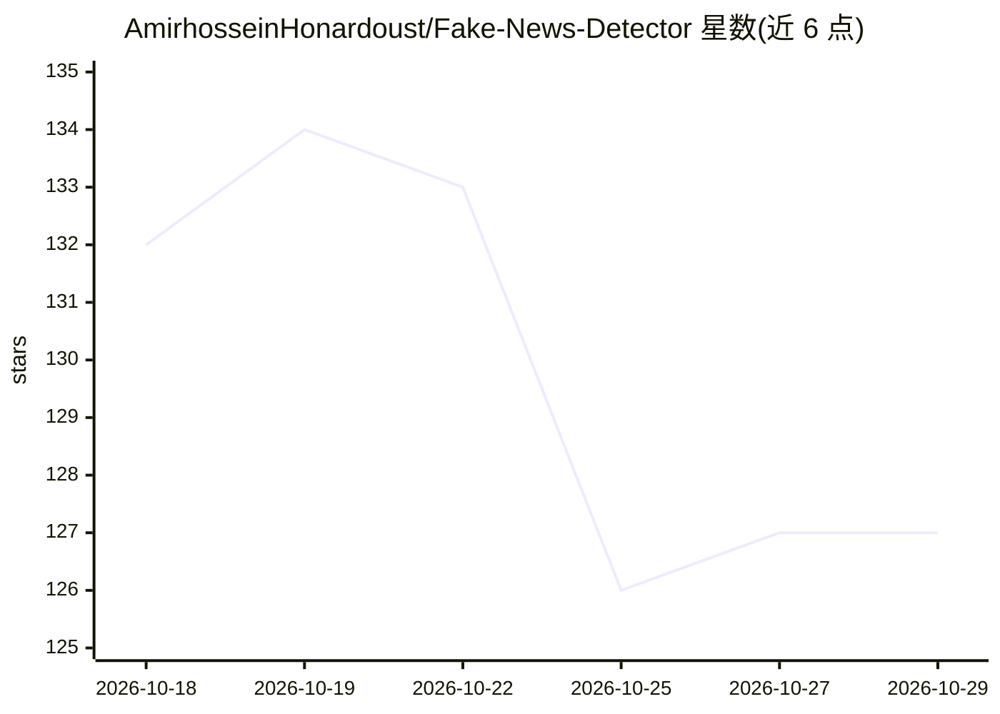

# AmirhosseinHonardoust/Fake-News-Detector

⭐ 127 · Python · MIT · 推送 2026-08-23 · [GitHub](https://github.com/AmirhosseinHonardoust/Fake-News-Detector) · 个人维护

**教育用新闻文本风格风险分类器（TF-IDF+逻辑回归）**

基于 TF-IDF 词 n-gram 与逻辑回归的新闻文本风格风险分类项目：读取带标签的真/假新闻数据集，训练管线并输出 REAL/FAKE/UNCERTAIN 三分类结果与概率。内置数据泄漏诊断（Reuters 启发式规则、来源混淆评分）、去源痕迹的泄漏受控训练、SHA-256 校验和的模型加载、Streamlit 交互面板、命令行 JSON 推理与单元测试及 CI。README 明确声明这是风格相似性估计与教学演示，不核验事实、不适用于事实核查或高风险决策；捆绑数据集仅 1,998 行且来源与标签完全混淆，无法做跨来源评估。

## 筛选速览

| 维度 | 判定 | 备注 |
|---|---|---|
| AI 角色 | `ai-native` | 本体是模型或模型工具 |
| 许可风险 | `permissive` | MIT |
| 部署形态 | `library` | 以包/库形式分发 |
| 模型依赖 | — | README 未给出锁定关系 |
| 硬件要求 | — | 无带数字的原话,不猜 |
| 安装摩擦 | `low` | 无编译、无系统依赖或容器化 |
| 成熟度 | — | 结构信号不足 |

## 能力要点

- REAL/FAKE/UNCERTAIN 三标签输出，可配置不确定性区间（默认 0.45–0.55）
- 两项数据泄漏诊断：Reuters 启发式规则与来源混淆评分（本数据集为 1.000）
- 去源痕迹泄漏受控训练与跨来源评估可行性自动判定
- SHA-256 校验和边车验证的模型加载与 Streamlit 面板

## 适用场景

- 学习带泄漏诊断与不确定性处理的文本分类工作流
- 演示分类器输出如何支撑可辩护的决策（含弃权区间）
- 作为负责任机器学习实践的教学/作品集案例

## 场景标签

 · 领域:NLP/机器学习

## 证据(README 行号)

> L11: A responsible machine learning project that turns news text into a **style-risk signal**, using a **TF-IDF + Logist
> L37: - Estimate whether the text resembles real-news or fake-news examples

## 星数曲线

2026-10-18 132 → 2026-10-29 127（-5）

---
*卡片 v1 · prompt 1.4 · 生成 2026-10-22 · 置信度 mid · 依据 README sha `0e43a6d7faa1` · [字段定义](../../DATASET.md)*
