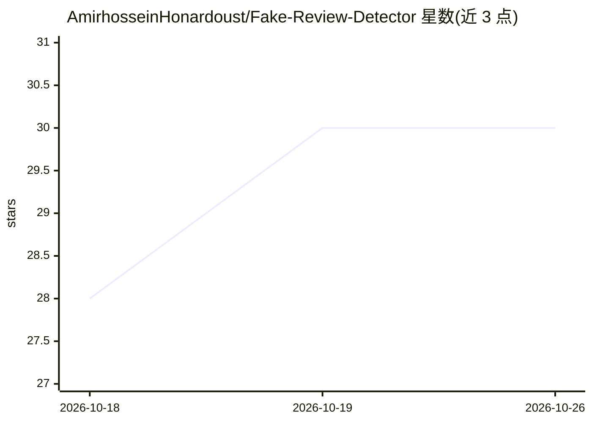

# AmirhosseinHonardoust/Fake-Review-Detector

⭐ 30 · Python · MIT · 推送 2025-10-31 · [GitHub](https://github.com/AmirhosseinHonardoust/Fake-Review-Detector) · 个人维护

**检测商品评论真假的机器学习项目：TF-IDF+逻辑回归+行为特征**

用 Python 与 Scikit-learn 训练的评论真假分类器：对 CSV 文本做清洗后，组合 TF-IDF（1–2 gram）特征与情感分数、感叹号/全大写检测、套话短语等行为特征，用逻辑回归训练并输出可调阈值的 FAKE/REAL 判定，附混淆矩阵、ROC、PR 曲线评估（样本数据为均衡合成数据）。提供 Streamlit 交互界面，可粘贴评论文本实时查看伪造概率。包含训练脚本与虚拟环境安装步骤。

## 筛选速览

| 维度 | 判定 | 备注 |
|---|---|---|
| AI 角色 | `ai-native` | 本体是模型或模型工具 |
| 许可风险 | `permissive` | MIT |
| 部署形态 | `None` |  |
| 模型依赖 | — | README 未给出锁定关系 |
| 硬件要求 | — | 无带数字的原话,不猜 |
| 安装摩擦 | `low` | 无编译、无系统依赖或容器化 |
| 成熟度 | — | 结构信号不足 |

## 能力要点

- TF-IDF（1–2 gram）与情感/行为数值特征的混合特征工程
- 逻辑回归模型，预测阈值可调
- Streamlit 交互界面：粘贴文本即时输出伪造概率
- 提供混淆矩阵、ROC、PR 曲线评估

## 适用场景

- 我想判断一条商品评论是否像伪造的
- 学习 TF-IDF+传统机器学习做文本分类的完整流程
- 在 Streamlit 上做文本分类演示

## 场景标签

 · 领域:NLP/文本分类

## 证据(README 行号)

> L3: A machine learning project that detects **fake vs real** product reviews using **TF-IDF vectorization**, **Logistic 
> L31: 4. **Modeling:** Logistic Regression trained on combined features.

## 星数曲线

2026-10-18 28 → 2026-10-26 30（+2）

---
*卡片 v1 · prompt 1.4 · 生成 2026-10-26 · 置信度 high · 依据 README sha `7bab6a0fa4cb` · [字段定义](../../DATASET.md)*
