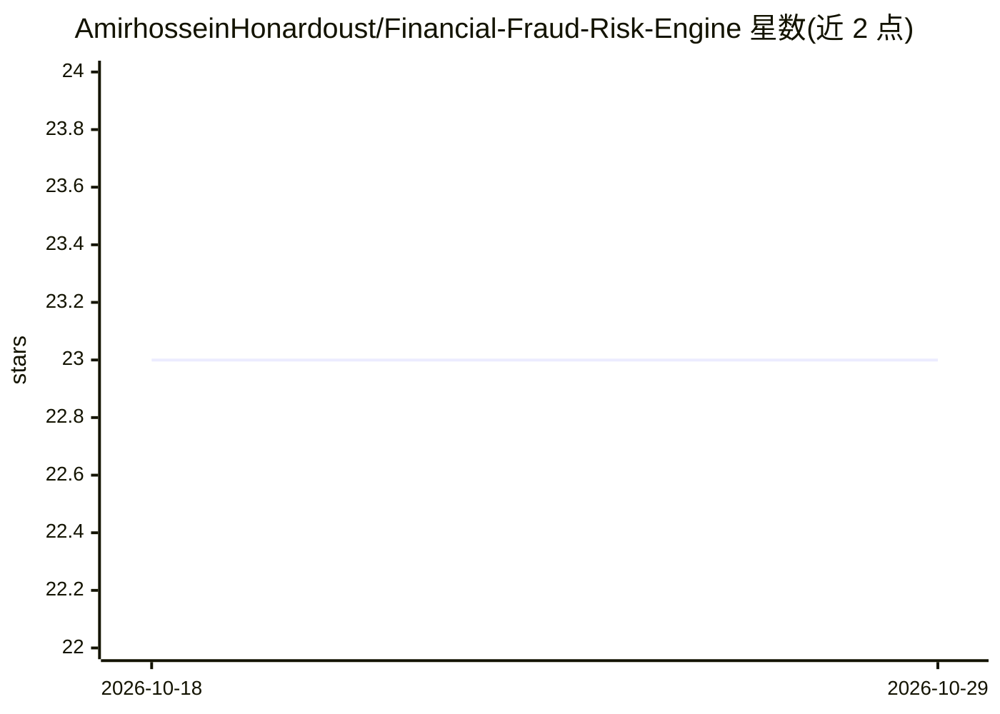

# AmirhosseinHonardoust/Financial-Fraud-Risk-Engine

⭐ 23 · Python · MIT · 推送 2026-08-13 · [GitHub](https://github.com/AmirhosseinHonardoust/Financial-Fraud-Risk-Engine) · 个人维护

**基于合成数据的金融欺诈风险端到端演示系统，含成本敏感阈值与 SHAP 解释**

面向金融科技场景的欺诈风险工作流演示项目：生成带类别不平衡与标签噪声的合成交易数据，用 scikit-learn 流水线训练欺诈风险模型，做 ROC-AUC/PR-AUC/Brier 等评估，按误报/漏报成本搜索阈值并生成五类策略工件（cost_optimized、balanced_f1 等），支持批量 CSV 打分、生成分析员可读的 reason codes，并用 Streamlit 仪表盘与 SHAP 展示解释。README 明确声明这是作品集与研究演示，数据为合成，不用于真实金融决策，也不含实时流式检测或漂移监控。

## 筛选速览

| 维度 | 判定 | 备注 |
|---|---|---|
| AI 角色 | `ai-native` | 本体是模型或模型工具 |
| 许可风险 | `permissive` | MIT |
| 部署形态 | `library` | 以包/库形式分发 |
| 模型依赖 | — | README 未给出锁定关系 |
| 硬件要求 | — | 无带数字的原话,不猜 |
| 安装摩擦 | `low` | 无编译、无系统依赖或容器化 |
| 成熟度 | — | 结构信号不足 |

## 能力要点

- 合成欺诈数据生成器，含重叠模式、标签噪声与类别不平衡
- 成本敏感阈值搜索与五种阈值策略工件（成本/F1/召回/精确/审核容量）
- 批量打分输出 fraud_probability、fraud_flag 与 reason codes
- Streamlit 仪表盘与 SHAP 单笔交易解释

## 适用场景

- 学习欺诈检测的完整风险决策工作流（数据→训练→阈值→打分→审核）
- 演示成本敏感阈值选择与审核容量权衡给业务方
- 参考不平衡数据下 PR-AUC/Brier 评估与 reason code 设计

## 场景标签

 · 领域:金融风控/机器学习

## 证据(README 行号)

> L32: This project demonstrates an end-to-end fraud-risk workflow using synthetic transaction data. It includes data prep
> L42: - Train a fraud-risk model using a scikit-learn pipeline

## 星数曲线

2026-10-18 23 → 2026-10-29 23（+0）

---
*卡片 v1 · prompt 1.4 · 生成 2026-10-27 · 置信度 mid · 依据 README sha `d4f254d7bb4f` · [字段定义](../../DATASET.md)*
