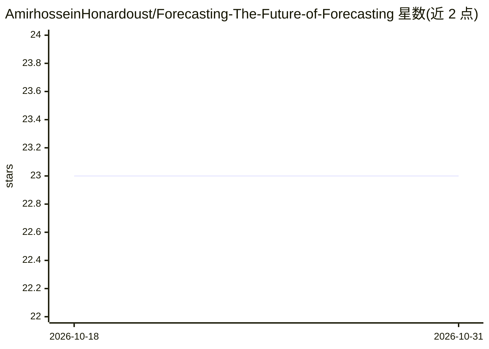

# AmirhosseinHonardoust/Forecasting-The-Future-of-Forecasting

⭐ 23 · MIT · 推送 2025-11-08 · [GitHub](https://github.com/AmirhosseinHonardoust/Forecasting-The-Future-of-Forecasting) · 个人维护

**关于 AI 驱动预测与反思性智能的专业英文长文**

仓库存放一篇题为 Forecasting the Future of Forecasting 的英文论述文章，讨论预测模型如何演变为战略性人机协作系统。内容覆盖不确定性建模、情景设计、类 ForecastFactory 的预测系统概念架构（含 Mermaid 流程图：SQL/ETL、Prophet/LSTM/XGBoost 模型、情景引擎、反馈回路与可视化层）、可解释性设计原则、反身性 AI 与预测伦理。参考文献列及 Prophet、XGBoost、Streamlit、Plotly、SHAP 等文档。仓库不含可安装或可运行的代码。

## 筛选速览

| 维度 | 判定 | 备注 |
|---|---|---|
| AI 角色 | `ai-knowledge` | 知识聚合/清单类 |
| 许可风险 | `permissive` | MIT |
| 部署形态 | `None` |  |
| 模型依赖 | — | README 未给出锁定关系 |
| 硬件要求 | — | 无带数字的原话,不猜 |
| 安装摩擦 | `low` | 无编译、无系统依赖或容器化 |
| 成熟度 | — | 结构信号不足 |

## 能力要点

- 以长文形式论述交互式前瞻与反思性 AI 的理念
- 给出含五层子系统的概念架构图（数据、模型、情景引擎、反馈、可视化）
- 梳理 MAE/RMSE/SMAPE/熵等指标的概念化解读
- 引用 Prophet、XGBoost、SHAP、Wiener、Pearl 等文献

## 适用场景

- 阅读 AI 预测系统设计的理念与架构参考
- 为预测系统的人机协作与可解释性设计寻找论述素材
- 了解反身性预测与预测伦理的讨论视角

## 场景标签

 · 领域:AI 预测/思想文章

## 证据(README 行号)

> L1: # Forecasting the Future of Forecasting: When AI Becomes a Strategy Partner
> L37: Below is a conceptual blueprint inspired by the architecture of *ForecastFactory*, an ecosystem where data pipeline
> L148: ## 10. References & Attributions

## 星数曲线

2026-10-18 23 → 2026-10-31 23（+0）

---
*卡片 v1 · prompt 1.4 · 生成 2026-10-27 · 置信度 high · 依据 README sha `eb3193d534b7` · [字段定义](../../DATASET.md)*
