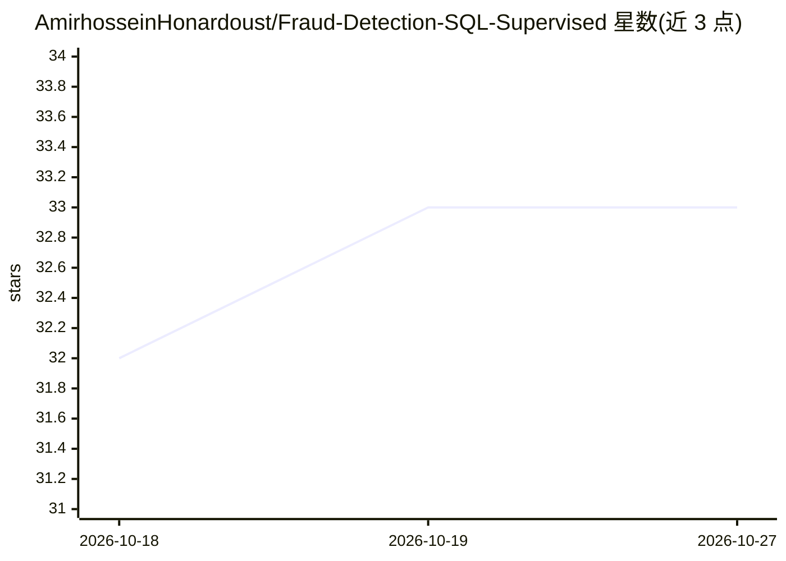

# AmirhosseinHonardoust/Fraud-Detection-SQL-Supervised

⭐ 33 · Python · MIT · 推送 2026-09-06 · [GitHub](https://github.com/AmirhosseinHonardoust/Fraud-Detection-SQL-Supervised) · 个人维护

**SQL+Python 欺诈交易风险排序流水线：供人工复核而非自动决策**

带标签交易 CSV 导入 SQLite，用 SQL 窗口函数计算逐用户/逐日行为特征（point-in-time 防泄漏），训练 Logistic Regression（默认）或 Random Forest（可选），输出 AUC/precision/recall/F1、ROC 图与按欺诈概率排序的交易/用户清单。提供命令行训练与推理、可配置阈值、joblib 模型持久化、pytest 与 CI 质量门（覆盖率≥90%）。README 明确声明为教学演示与风险排序工具，不做在线评分、不自动批准或拦截交易，不适用于高风险金融决策。

## 筛选速览

| 维度 | 判定 | 备注 |
|---|---|---|
| AI 角色 | `ai-native` | 本体是模型或模型工具 |
| 许可风险 | `permissive` | MIT |
| 部署形态 | `library` | 以包/库形式分发 |
| 模型依赖 | — | README 未给出锁定关系 |
| 硬件要求 | — | 无带数字的原话,不猜 |
| 安装摩擦 | `low` | 无编译、无系统依赖或容器化 |
| 成熟度 | — | 结构信号不足 |

## 能力要点

- SQLite 窗口函数特征工程，point-in-time 聚合防止未来信息泄漏
- Logistic Regression 基线 + 可选 Random Forest，类别不平衡用 balanced 权重
- 输出按欺诈概率排序的交易明细与 top 200 用户汇总，供人工复核
- pytest 单元测试 + GitHub Actions CI，90% 覆盖率门槛

## 适用场景

- 学习 leakage-safe 的 SQL+Python 分类流水线工程实践
- 对带标签交易数据生成欺诈风险排序供人工复核
- 作为可复现的教学/作品集项目（含测试、CI、依赖锁定）

## 场景标签

`数据分析` · 领域:效率与自动化

## 证据(README 行号)

> L11: A responsible machine learning project that turns labeled transactions into a **fraud-risk ranking**, using **SQL (
> L40: - Score every transaction with a fraud probability and rank them by risk

## 星数曲线

2026-10-18 32 → 2026-10-27 33（+1）

---
*卡片 v1 · prompt 1.4 · 生成 2026-10-25 · 置信度 high · 依据 README sha `e70f1fa0f5be` · [字段定义](../../DATASET.md)*
