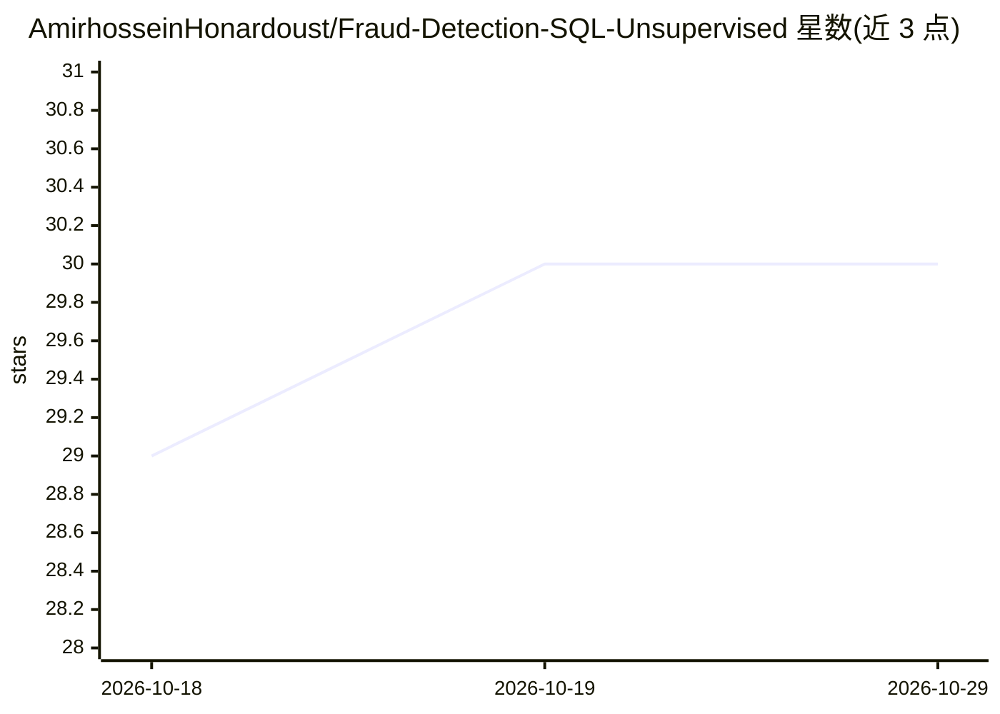

# AmirhosseinHonardoust/Fraud-Detection-SQL-Unsupervised

⭐ 30 · Python · MIT · 推送 2026-09-06 · [GitHub](https://github.com/AmirhosseinHonardoust/Fraud-Detection-SQL-Unsupervised) · 个人维护

**SQL 特征工程 + Isolation Forest 的交易异常排序演示项目**

将银行交易 CSV 载入 SQLite，用 SQL 视图计算用户级与按日行为聚合特征，输入无监督 Isolation Forest，输出每笔交易 0–1 的归一化异常分并排序，生成排名 CSV、用户汇总表与分布图。CLI 可配置特征列、污染率与随机种子，固定种子下结果可复现。README 明确声明这是异常排序演示而非已验证的欺诈检测系统，无标签数据、不报告精度，禁止用于封号等高风险决策，定位为作品集与教学演示。

## 筛选速览

| 维度 | 判定 | 备注 |
|---|---|---|
| AI 角色 | `ai-native` | 本体是模型或模型工具 |
| 许可风险 | `permissive` | MIT |
| 部署形态 | `library` | 以包/库形式分发 |
| 模型依赖 | — | README 未给出锁定关系 |
| 硬件要求 | — | 无带数字的原话,不猜 |
| 安装摩擦 | `low` | 无编译、无系统依赖或容器化 |
| 成熟度 | — | 结构信号不足 |

## 能力要点

- 特征工程全部以 SQLite 视图（SQL）实现，含引号感知的 SQL 语句切分器
- Isolation Forest 异常分（0–1）排序输出，固定 seed 确定性可复现
- CLI 可配置特征列、contamination 与随机种子，无需改代码
- src/ 100% 测试覆盖，Ruff/Black/mypy/pytest CI 质量门（Python 3.11/3.12）

## 适用场景

- 学习 SQL 驱动的特征工程与无监督异常检测流程
- 练习可复现、CI 门控的 Python 数据管道设计
- 作品集展示：端到端交易数据异常排序管道

## 场景标签

`数据分析` `教程课程` · 领域:效率与自动化

## 证据(README 行号)

> L11: A practical machine learning project that turns raw bank transactions into a **ranked anomaly signal**, using **SQL
> L38: - Feed those aggregates into an unsupervised Isolation Forest

## 星数曲线

2026-10-18 29 → 2026-10-29 30（+1）

---
*卡片 v1 · prompt 1.4 · 生成 2026-10-26 · 置信度 mid · 依据 README sha `f848986aa0a5` · [字段定义](../../DATASET.md)*
