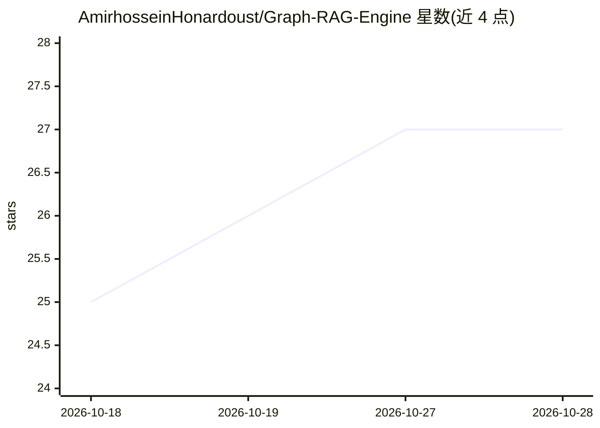

# AmirhosseinHonardoust/Graph-RAG-Engine

⭐ 27 · Python · MIT · 推送 2026-08-21 · [GitHub](https://github.com/AmirhosseinHonardoust/Graph-RAG-Engine) · 个人维护

**可解释的图+向量混合检索 RAG 系统：答案带引用与推理路径**

面向本地 Markdown 文档的检索问答系统：将文档分块并抽取轻量概念，用 Sentence Transformers 嵌入与 FAISS 建向量索引，用 NetworkX 构建文档-分块-概念知识图，按嵌入相似度、概念重叠与 PageRank 混合重排，返回带引用、图推理路径与逐项打分明细的检索轨迹。默认抽取式回答模式无需 API key，可选接入 OpenAI 兼容 API 生成回答；内置 35 条 golden query 基准（Hit@K/MRR/nDCG@K）与回归门禁。以 FastAPI 后端 + Streamlit 前端提供，pip 可编辑安装并注册 CLI 命令。README 明确声明非生产级系统，不含访问控制与监控。

## 筛选速览

| 维度 | 判定 | 备注 |
|---|---|---|
| AI 角色 | `ai-native` | 本体是模型或模型工具 |
| 许可风险 | `permissive` | MIT |
| 部署形态 | `library` | 以包/库形式分发 |
| 模型依赖 | — | README 未给出锁定关系 |
| 硬件要求 | — | 无带数字的原话,不猜 |
| 安装摩擦 | `low` | 无编译、无系统依赖或容器化 |
| 成熟度 | — | 结构信号不足 |

## 能力要点

- 图扩展 + FAISS 向量检索 + 混合重排（0.60 相似度 + 0.25 概念重叠 + 0.15 PageRank）
- 默认抽取式回答无需 API key，LLM 模式为可选且无凭证时回退
- 检索轨迹暴露打分组件与匹配概念，便于调试
- 内置 golden query 评测（Hit@K/Precision@K/Recall@K/MRR/nDCG@K）与基线回归门禁

## 适用场景

- 对本地 Markdown 文档库做带引用的可解释问答
- 调试并解释 RAG 检索为何选中某些来源
- 以评测基准跟踪检索质量回归

## 场景标签

`RAG` `文档问答` · 领域:知识与检索

## 证据(README 行号)

> L12: An explainable **Graph + Vector Retrieval** system that indexes Markdown documents, builds a lightweight knowledge 
> L55: - Return extractive answers with citations
> L61: - Optionally generate grounded LLM answers from retrieved context

## 星数曲线

2026-10-18 25 → 2026-10-28 27（+2）

---
*卡片 v1 · prompt 1.4 · 生成 2026-10-26 · 置信度 high · 依据 README sha `ea8676d6e381` · [字段定义](../../DATASET.md)*
