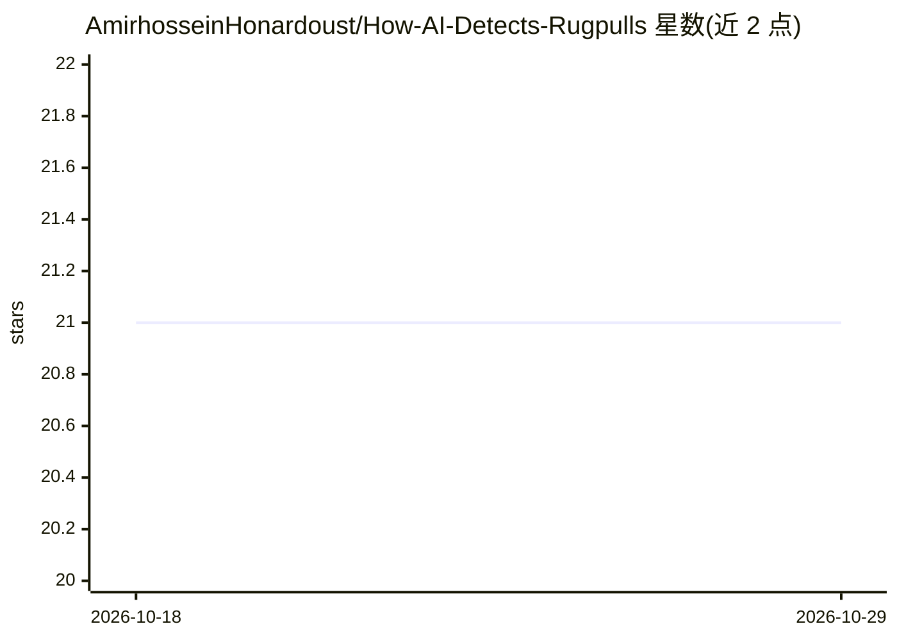

# AmirhosseinHonardoust/How-AI-Detects-Rugpulls

⭐ 21 · MIT · 推送 2025-11-19 · [GitHub](https://github.com/AmirhosseinHonardoust/How-AI-Detects-Rugpulls) · 个人维护

**技术文章：讲解如何用特征工程与评分模型检测 ERC-20 骗局代币**

一篇深度技术文章（非可运行软件），面向区块链安全研究者与 DeFi 开发者，讲解 rugpull 检测方法：将 Solidity 合约文本转换为结构化特征向量（owner 铸币、费率操纵、黑名单、交易锁等二值特征），再按权重求和生成 0-100 的风险分并映射到 safe/suspicious/rugpull_candidate 标签。文中给出纯 Python 正则特征提取示例、三档风险分级、示例推演，并说明如何用 scikit-learn 训练真实 ML 模型及 SHAP 可解释性扩展。静态分析无法检测运行时漏洞、流动性行为与可升级代理陷阱等限制也被列出。

## 筛选速览

| 维度 | 判定 | 备注 |
|---|---|---|
| AI 角色 | `ai-knowledge` | 知识聚合/清单类 |
| 许可风险 | `permissive` | MIT |
| 部署形态 | `None` |  |
| 模型依赖 | — | README 未给出锁定关系 |
| 硬件要求 | — | 无带数字的原话,不猜 |
| 安装摩擦 | `low` | 无编译、无系统依赖或容器化 |
| 成熟度 | — | 结构信号不足 |

## 能力要点

- 将 Solidity 代码转为二值特征向量的特征工程方法
- 加权求和风险评分引擎（如 owner 铸币 +40、费率操纵 +25）
- 0-100 分映射 safe/suspicious/rugpull_candidate 三档标签
- 给出迁移到真实 ML 模型（RandomForest + SHAP）的步骤

## 适用场景

- 学习如何对 ERC-20 代币合约做风险特征提取与评分
- 了解 rugpull 常见 Solidity 模式（铸币/费率/黑名单/交易锁）
- 作为构建代币审计或风险评分工具的方法参考

## 场景标签

`网络安全` `教程课程` · 领域:学习与行业

## 证据(README 行号)

> L1: # **How AI Detects Rugpulls Before Humans Notice: Inside Token Risk Scoring**
> L3: ### A Deep Dive into Feature Engineering, Security Patterns, and ML-Inspired Analysis for ERC-20 Token Scam Detectio
> L24: This article explains exactly how that works, step by step.

## 星数曲线

2026-10-18 21 → 2026-10-29 21（+0）

---
*卡片 v1 · prompt 1.4 · 生成 2026-10-28 · 置信度 high · 依据 README sha `d71021aa38a1` · [字段定义](../../DATASET.md)*
