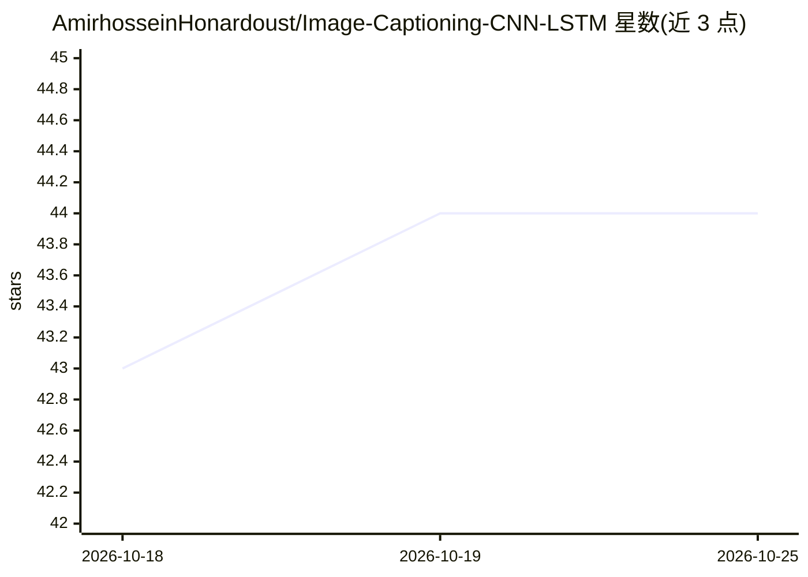

# AmirhosseinHonardoust/Image-Captioning-CNN-LSTM

⭐ 44 · Python · MIT · 推送 2026-07-01 · [GitHub](https://github.com/AmirhosseinHonardoust/Image-Captioning-CNN-LSTM) · 个人维护

**教育级 CNN-LSTM 图像描述生成基线项目（PyTorch）**

端到端的图像描述生成深度学习项目：ResNet-50 作为视觉编码器提取特征，LSTM 解码器逐词生成描述文本，并提供可选的 Show, Attend and Tell 注意力解码器。覆盖词表构建、CSV 数据预处理、训练、BLEU-1~4 多引用评估、贪心与束搜索推理，保存 checkpoint、词表、指标与损失/BLEU 曲线。自述为教育基线：内置演示数据集极小，仅用于验证流水线，不提供生产级描述效果，不替代 transformer 视觉语言模型，仓库不含预训练权重。附 Pytest 测试套件与 GitHub Actions CI，提供 Flickr8k 数据转换脚本。

## 筛选速览

| 维度 | 判定 | 备注 |
|---|---|---|
| AI 角色 | `ai-native` | 本体是模型或模型工具 |
| 许可风险 | `permissive` | MIT |
| 部署形态 | `library` | 以包/库形式分发 |
| 模型依赖 | — | README 未给出锁定关系 |
| 硬件要求 | — | 无带数字的原话,不猜 |
| 安装摩擦 | `low` | 无编译、无系统依赖或容器化 |
| 成熟度 | `idea` | |

## 能力要点

- ResNet-50 编码器 + LSTM 解码器，可选注意力解码器（--decoder attention）
- BLEU-1~4 多引用评估、贪心与束搜索两种解码策略
- 训练/验证/测试划分、早停、梯度裁剪、checkpoint 与指标保存
- Pytest 测试套件与 GitHub Actions CI（ruff/black/mypy）

## 适用场景

- 学习图像描述生成的经典编码器-解码器流水线
- 在自己的 CSV 图像描述数据集上训练与评估（含 Flickr8k 转换脚本）
- 对比基线 LSTM 与注意力解码器的训练与推理效果

## 场景标签

`多模态` `教程课程` · 领域:学习与行业

## 证据(README 行号)

> L5: A deep learning project that generates natural-language captions for images using a **CNN encoder** and an **LSTM de
> L19: Given an input image, the model learns to generate a text caption that describes the visual content of the image.

## 星数曲线

2026-10-18 43 → 2026-10-25 44（+1）

---
*卡片 v1 · prompt 1.4 · 生成 2026-10-25 · 置信度 mid · 依据 README sha `1c51fd759a72` · [字段定义](../../DATASET.md)*
