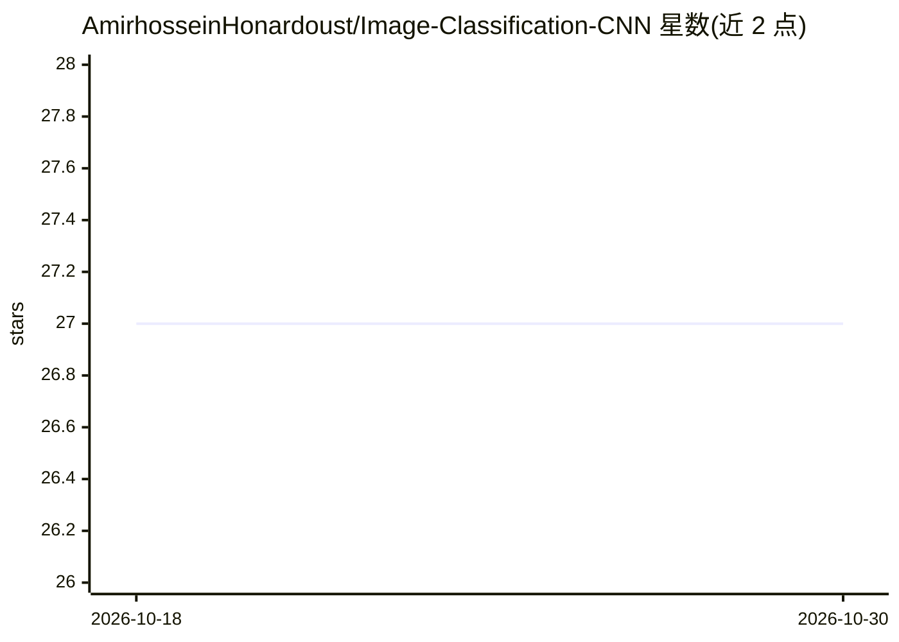

# AmirhosseinHonardoust/Image-Classification-CNN

⭐ 27 · Python · MIT · 推送 2026-09-06 · [GitHub](https://github.com/AmirhosseinHonardoust/Image-Classification-CNN) · 个人维护

**PyTorch CNN 手写数字识别教学项目：MNIST 训练到 99.35%**

基于 PyTorch 的图像分类项目，用两层卷积+池化+全连接的 CNN 识别 MNIST 手写数字，含早停、最佳检查点保存、类型化配置合并（默认值→JSON→CLI）、独立评估脚本、混淆矩阵与训练曲线等可视化，测试集准确率 99.35%。README 明确定位为教育与作品集演示，不适用于生产识别系统，不处理彩色或变分辨率图像，也不提供推理 API。提供 pip 安装、train-cnn/evaluate-cnn 命令行脚本与 Docker 训练镜像。

## 筛选速览

| 维度 | 判定 | 备注 |
|---|---|---|
| AI 角色 | `ai-native` | 本体是模型或模型工具 |
| 许可风险 | `permissive` | MIT |
| 部署形态 | `self-host` | docker 或自建部署 |
| 模型依赖 | — | README 未给出锁定关系 |
| 硬件要求 | — | 无带数字的原话,不猜 |
| 安装摩擦 | `low` | 无编译、无系统依赖或容器化 |
| 成熟度 | — | 结构信号不足 |

## 能力要点

- CNN 训练流水线：早停、最佳检查点、配置三层合并（defaults→JSON→CLI）
- 评估输出准确率/宏精确率/宏召回/宏 F1 并写入 metrics.json
- 混淆矩阵、训练曲线、样例预测可视化
- 单元测试、GitHub Actions CI 与 Docker 训练镜像

## 适用场景

- 学习 CNN 架构设计与训练循环的完整工程化流程
- 作为可复现的 ML 作品集演示项目
- 练习配置驱动、可测试的机器学习项目结构

## 场景标签

`目标检测` `教程课程` · 领域:学习与行业

## 证据(README 行号)

> L11: An image classification project built with **PyTorch**, using a **Convolutional Neural Network (CNN)** to recognize
> L36: - Train a CNN on the MNIST dataset (28×28 grayscale digit images)

## 星数曲线

2026-10-18 27 → 2026-10-30 27（+0）

---
*卡片 v1 · prompt 1.4 · 生成 2026-10-26 · 置信度 high · 依据 README sha `0a3bf38a8578` · [字段定义](../../DATASET.md)*
