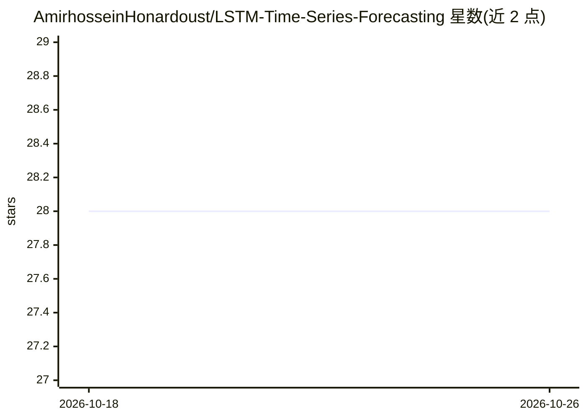

# AmirhosseinHonardoust/LSTM-Time-Series-Forecasting

⭐ 28 · Python · MIT · 推送 2026-09-06 · [GitHub](https://github.com/AmirhosseinHonardoust/LSTM-Time-Series-Forecasting) · 个人维护

**PyTorch LSTM 时间序列预测教学/作品集项目，含合成数据生成与评估**

端到端的单变量时间序列预测流水线：脚本生成含趋势、季节性、事件与噪声的合成日序列，滑窗构造监督样本，训练带 dropout、Adam 与早停的 LSTM，一次前向直接输出多步预测，用 RMSE/MAE/MAPE 在预留段回测并绘图。检查点内嵌架构配置，评估时自动重建模型。限制：仅单变量、无超参搜索，指标为回测而非真实未来预测；作者定位为作品集演示。

## 筛选速览

| 维度 | 判定 | 备注 |
|---|---|---|
| AI 角色 | `ai-native` | 本体是模型或模型工具 |
| 许可风险 | `permissive` | MIT |
| 部署形态 | `library` | 以包/库形式分发 |
| 模型依赖 | — | README 未给出锁定关系 |
| 硬件要求 | — | 无带数字的原话,不猜 |
| 安装摩擦 | `medium` | 含编译或系统依赖之一 |
| 成熟度 | — | 结构信号不足 |

## 能力要点

- 滑窗样本准备 + LSTM（dropout/Adam/早停）直接多步预测
- 检查点内嵌架构配置，评估脚本自动重建同构模型
- RMSE/MAE/MAPE 回测指标与训练曲线、预测对比图
- 单元测试、GitHub Actions CI 与 Ruff/Black/mypy 质量配置

## 适用场景

- 学习可复现的 PyTorch LSTM 预测流水线完整流程
- 替换 CSV 数据源做单变量序列的多步回测
- 作为时间序列预测作品集/课程项目参考实现

## 场景标签

`教程课程` · 领域:学习与行业

## 证据(README 行号)

> L10: A hands-on project for forecasting time-series with **PyTorch LSTMs**. It creates realistic daily data (trend, seas
> L25: - predict a full horizon in one forward pass (direct multi-step forecasting)
> L40: - Compute RMSE, MAE, and MAPE on a held-out portion of the series

## 星数曲线

2026-10-18 28 → 2026-10-26 28（+0）

---
*卡片 v1 · prompt 1.4 · 生成 2026-10-26 · 置信度 mid · 依据 README sha `eb75b4c04df7` · [字段定义](../../DATASET.md)*
