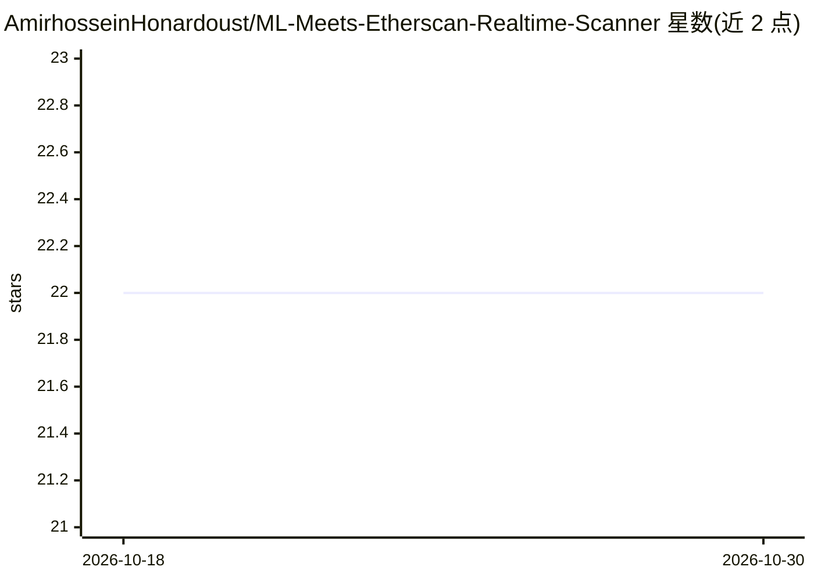

# AmirhosseinHonardoust/ML-Meets-Etherscan-Realtime-Scanner

⭐ 22 · MIT · 推送 2025-11-20 · [GitHub](https://github.com/AmirhosseinHonardoust/ML-Meets-Etherscan-Realtime-Scanner) · 个人维护

**教程文章：讲解如何构建实时智能合约 ML 风险扫描管线**

以长文形式讲解一套实时智能合约安全管线的架构设计：通过 Etherscan V2 或 WebSocket 监听新部署合约，抓取已验证 Solidity 源码，进行基于模式的静态风险审计（铸币权限、黑名单、交易锁、费率操纵等），生成特征向量后用 RandomForestClassifier 等模型输出合约风险分与标签，再基于部署者历史构建第二个特征向量计算部署者信任分，最终输出 JSON 风险报告。README 未提供可运行的代码入口或安装命令，属于架构讲解/教程文本，面向区块链安全方向的开发与学习人群。

## 筛选速览

| 维度 | 判定 | 备注 |
|---|---|---|
| AI 角色 | `ai-knowledge` | 知识聚合/清单类 |
| 许可风险 | `permissive` | MIT |
| 部署形态 | `None` |  |
| 模型依赖 | — | README 未给出锁定关系 |
| 硬件要求 | — | 无带数字的原话,不猜 |
| 安装摩擦 | `low` | 无编译、无系统依赖或容器化 |
| 成熟度 | — | 结构信号不足 |

## 能力要点

- 五层架构：部署监听→静态审计→ML 合约分类→部署者信誉→端到端编排
- 静态审计提取 mint/blacklist/交易锁等二元特征构成 ML 特征向量
- 合约级 risk_score 与部署者级 trust_score 双重评分，输出 JSON 报告

## 适用场景

- 学习实时合约风险扫描管线的架构设计
- 参考特征工程设计自己的合约安全分类器
- 了解部署者信誉评分的思路

## 场景标签

`网络安全` `教程课程` · 领域:学习与行业

## 证据(README 行号)

> L9: In this article, we build exactly that. Step by step. Fully explained.
> L285: Real-time smart contract scanning is not science fiction.

## 星数曲线

2026-10-18 22 → 2026-10-30 22（+0）

---
*卡片 v1 · prompt 1.4 · 生成 2026-10-28 · 置信度 low · 依据 README sha `54b9c34fe240` · [字段定义](../../DATASET.md)*
