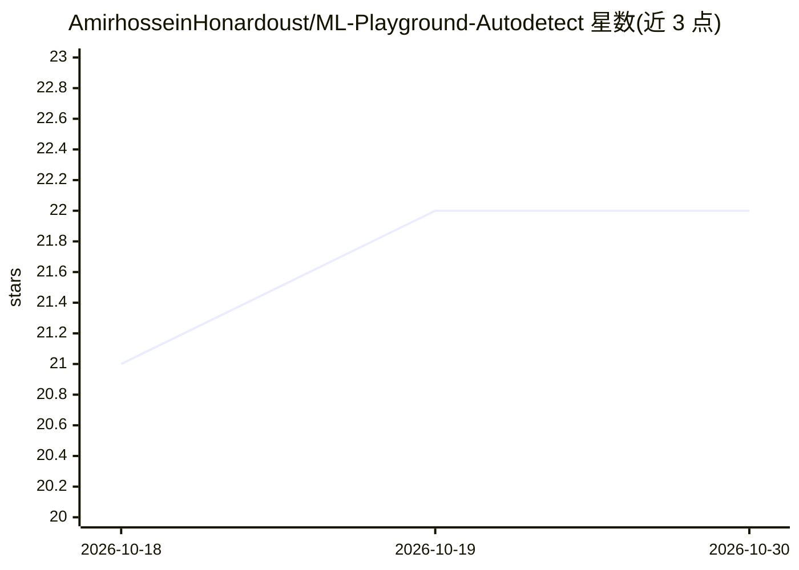

# AmirhosseinHonardoust/ML-Playground-Autodetect

⭐ — · [GitHub]() · 个人维护

**浏览器内自动识别分类/回归并交互训练模型的 ML 工具**

基于 Streamlit 与 Scikit-learn 的交互式机器学习 Web 应用：用户上传 CSV 或使用内置样例，系统根据目标列的数据类型与唯一值启发式自动判定分类或回归任务，构建含数值标准化与类别 OneHot 编码的 ColumnTransformer 预处理管道，训练 Logistic Regression、Random Forest、（可选）XGBoost 等模型，用 Plotly 展示混淆矩阵、ROC、残差等指标，并导出 joblib 管道与预测 CSV。面向数据分析师、ML 学生、教育者与开发者，可本地、Streamlit Cloud、Docker 或 Hugging Face Spaces 部署。兼容 scikit-learn 0.24+ 各版本。

## 筛选速览

| 维度 | 判定 | 备注 |
|---|---|---|
| AI 角色 | `ai-native` | 本体是模型或模型工具 |
| 许可风险 | `permissive` | — |
| 部署形态 | `self-host` | docker 或自建部署 |
| 模型依赖 | — | README 未给出锁定关系 |
| 硬件要求 | — | 无带数字的原话,不猜 |
| 安装摩擦 | `low` | 无编译、无系统依赖或容器化 |
| 成熟度 | — | 结构信号不足 |

## 能力要点

- 自动判定分类/回归任务，阻止无效配置
- ColumnTransformer 预处理 + Pipeline 封装，joblib 导出复用
- Plotly 交互式混淆矩阵/ROC/残差可视化
- 兼容 scikit-learn 0.24+ 的多版本参数差异

## 适用场景

- 上传 CSV 快速原型验证分类或回归模型
- 教学演示机器学习流程与指标含义
- 训练后导出完整管道用于生产脚本

## 场景标签

`数据分析` · 领域:效率与自动化

## 证据(README 行号)

> L3: An interactive **Streamlit + Scikit‑Learn** web application that allows anyone to upload a dataset, automatically id
> L31: |**Task Detection Engine**|Analyzes target column distribution to classify problem type (classification vs regressi
> L33: |**Training Engine**|Constructs scikit-learn Pipeline, trains model, evaluates metrics.|

## 星数曲线

2026-10-18 21 → 2026-10-30 22（+1）

---
*卡片 v1 · prompt 1.4 · 生成 2026-10-28 · 置信度 mid · 依据 README sha `d55737e62359` · [字段定义](../../DATASET.md)*
