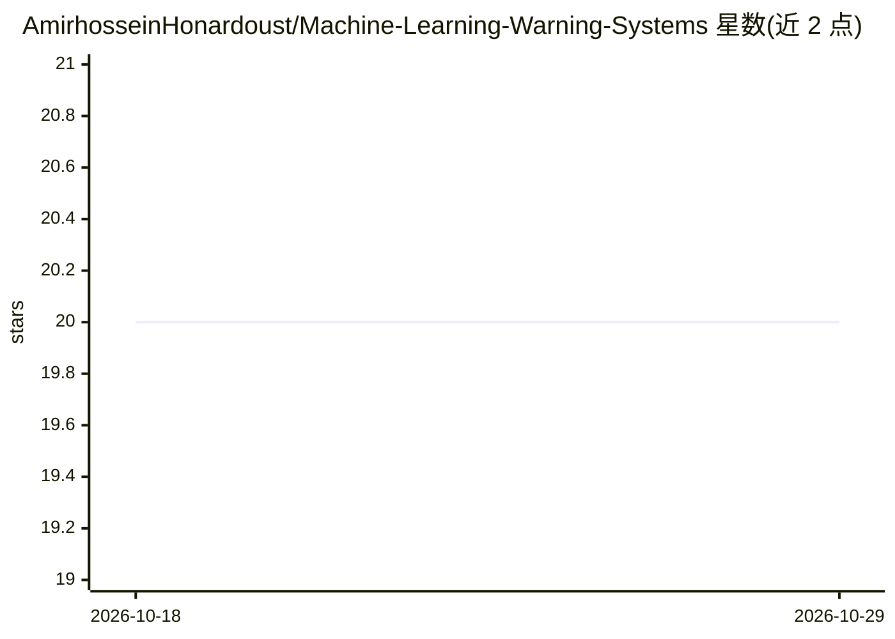

# AmirhosseinHonardoust/Machine-Learning-Warning-Systems

⭐ 20 · MIT · 推送 2025-12-20 · [GitHub](https://github.com/AmirhosseinHonardoust/Machine-Learning-Warning-Systems) · 个人维护

**面向 ML 从业者的警告式系统设计长文与框架**

一篇关于机器学习系统伦理设计的长文：主张模型应发出警告而非直接决策，以保留人类能动性。内容包括：分数如何转化为隐性控制的机制分析、六种把警告变成控制的失败模式、八条伦理警告原则（状态优先、区间优先、可逆性、可争议性、审计等）、防止软性强制的 UI 设计模式，以及包含信号、区间、置信级别、杠杆与失效期的八字段 Warning Card 输出模板。面向构建风险评估或预测系统的 ML 从业者与产品设计师。仅以文章形式提供，无可安装代码。

## 筛选速览

| 维度 | 判定 | 备注 |
|---|---|---|
| AI 角色 | `ai-knowledge` | 知识聚合/清单类 |
| 许可风险 | `permissive` | MIT |
| 部署形态 | `None` |  |
| 模型依赖 | — | README 未给出锁定关系 |
| 硬件要求 | — | 无带数字的原话,不猜 |
| 安装摩擦 | `low` | 无编译、无系统依赖或容器化 |
| 成熟度 | — | 结构信号不足 |

## 能力要点

- 八条伦理警告原则（状态优先、区间优先、杠杆优先、默认可逆等）
- 八字段 Warning Card 输出模板（信号/区间/置信级别/杠杆/失效期等）
- 六种警告退化为控制的失败模式分析
- 强制性与保留能动性的 UI 设计模式清单

## 适用场景

- 设计风险评估类 ML 系统时参考的伦理框架
- 为警告输出制定统一格式与失效机制
- 审查现有系统 UI 是否造成软性自动化强制

## 场景标签

 · 领域:AI 伦理/ML 系统设计

## 证据(README 行号)

> L21: This article is a blueprint for building ML systems that **warn**, not decide.
> L256: ## 5) The 8 principles of ethical warnings (a practical framework)
> L321: ## 7) The Warning Card: a concrete output template

## 星数曲线

2026-10-18 20 → 2026-10-29 20（+0）

---
*卡片 v1 · prompt 1.4 · 生成 2026-10-28 · 置信度 high · 依据 README sha `8f89e8798dbd` · [字段定义](../../DATASET.md)*
