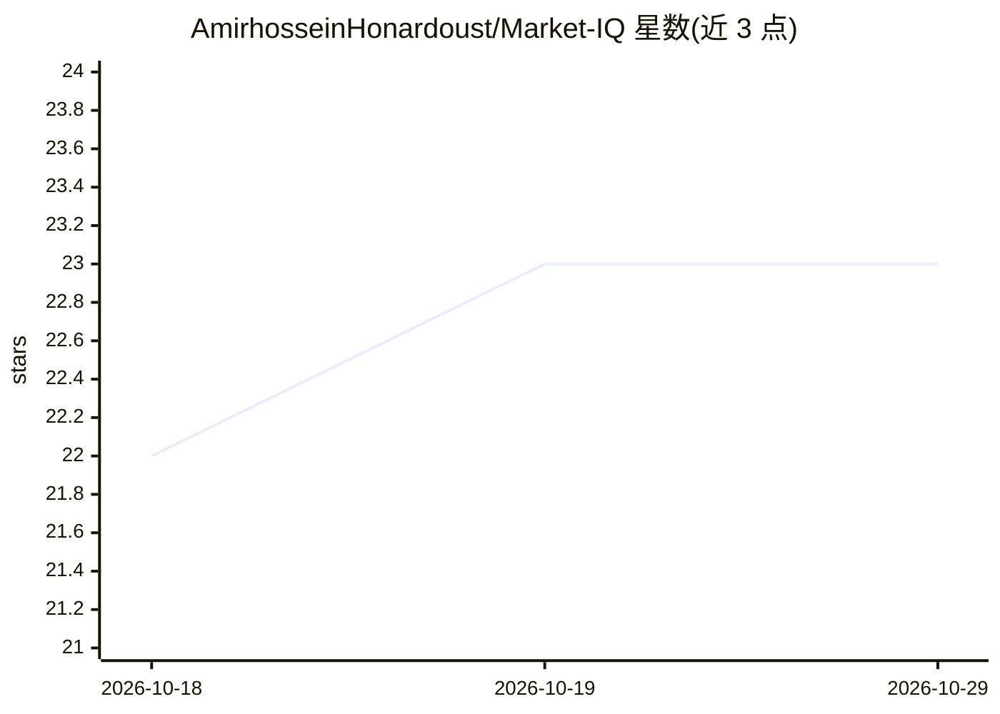

# AmirhosseinHonardoust/Market-IQ

⭐ 23 · Python · MIT · 推送 2025-11-05 · [GitHub](https://github.com/AmirhosseinHonardoust/Market-IQ) · 个人维护

**面向分析师的 SQL 销售分析与 Prophet 预测仪表盘**

基于 Streamlit 构建的全栈商业智能仪表盘：从 SQLite（可选 PostgreSQL）读取星型模型销售数据，经 Pandas/SQLAlchemy 处理后以 Plotly 呈现 KPI、趋势、渠道与产品排行等图表，支持日期过滤与 CSV/PNG 导出。预测模块用 Prophet 生成 6 个月带置信区间的销售预测，未安装时预测功能自动禁用、分析功能保持可用。面向分析师、初创团队与数据团队。

## 筛选速览

| 维度 | 判定 | 备注 |
|---|---|---|
| AI 角色 | `ai-enhanced` | 去掉 AI 部分产品仍成立 |
| 许可风险 | `permissive` | MIT |
| 部署形态 | `None` |  |
| 模型依赖 | — | README 未给出锁定关系 |
| 硬件要求 | — | 无带数字的原话,不猜 |
| 安装摩擦 | `low` | 无编译、无系统依赖或容器化 |
| 成熟度 | — | 结构信号不足 |

## 能力要点

- SQL 驱动的 KPI 看板（收入/订单/客户/AOV/MoM 增长）
- Prophet 生成 6 个月销售预测并含置信区间
- 日期区间过滤动态联动全部图表，可导出 CSV/PNG
- 星型模型 SQL schema（fact_sales + 维度表与视图）

## 适用场景

- 可视化查看销售 KPI 与趋势、渠道与产品排行
- 基于历史数据做 6 个月销售预测辅助备货与预算
- 按日期区间筛选并导出报表用于汇报

## 场景标签

`数据分析` · 领域:效率与自动化

## 证据(README 行号)

> L3: **MarketIQ** is a full-featured **Streamlit-powered analytics platform** that integrates **SQL-driven data pipelines
> L10: With built-in **Prophet forecasting**, it projects future trends based on historical sales.
> L39: **Forecast Module:** Prophet predicts future sales with confidence intervals.
> L158: If Prophet is not installed, MarketIQ gracefully disables forecasting but remains fully functional for SQL-driven 

## 星数曲线

2026-10-18 22 → 2026-10-29 23（+1）

---
*卡片 v1 · prompt 1.4 · 生成 2026-10-27 · 置信度 high · 依据 README sha `bfff29c8808e` · [字段定义](../../DATASET.md)*
