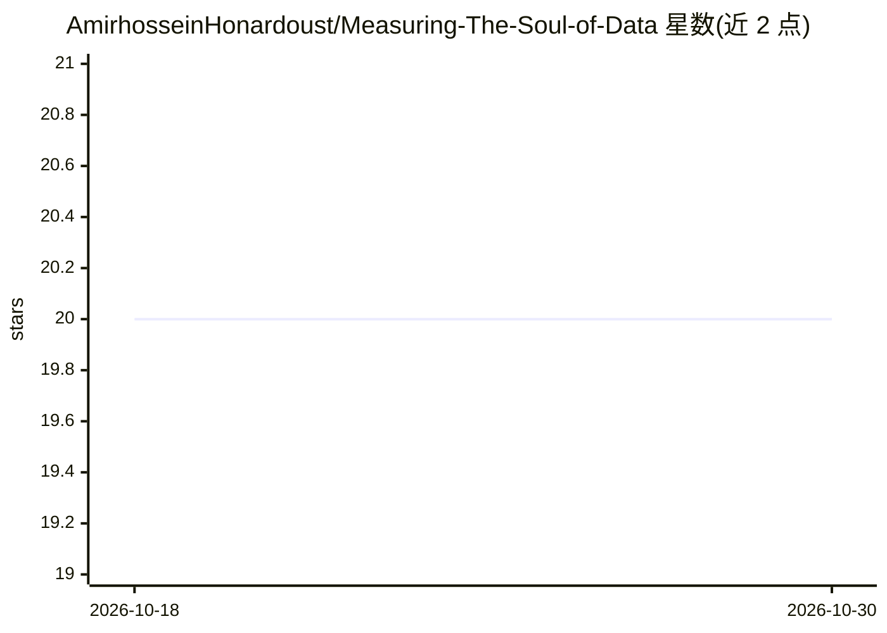

# AmirhosseinHonardoust/Measuring-The-Soul-of-Data

⭐ 20 · MIT · 推送 2025-11-14 · [GitHub](https://github.com/AmirhosseinHonardoust/Measuring-The-Soul-of-Data) · 个人维护

**合成数据质量四维度（保真/覆盖/隐私/效用）的叙事与技术解读**

一篇结合叙事、数学与代码示例的文章型仓库：讲解合成数据真实性的四个度量维度——Fidelity（JSD/KS/Wasserstein 距离）、Coverage（特征空间的 precision/recall 类指标）、Privacy（最近邻距离 NND 与成员推断攻击 AUC）、Utility（TSTR/TRTS 范式），并讨论指标间的多目标权衡。第 8 节使用 Autocurator 框架给出一组示例基准结果。面向关注合成数据评估与数据伦理的读者；正文代码为讲解性片段，未提供本仓库自身的安装或运行说明。

## 筛选速览

| 维度 | 判定 | 备注 |
|---|---|---|
| AI 角色 | `ai-knowledge` | 知识聚合/清单类 |
| 许可风险 | `permissive` | MIT |
| 部署形态 | `None` |  |
| 模型依赖 | — | README 未给出锁定关系 |
| 硬件要求 | — | 无带数字的原话,不猜 |
| 安装摩擦 | `low` | 无编译、无系统依赖或容器化 |
| 成熟度 | — | 结构信号不足 |

## 能力要点

- 四维度指标体系：Fidelity/Coverage/Privacy/Utility
- 每个维度附 Python 代码片段与解读表格
- 展示指标间权衡（保真↑则隐私↓等多目标关系）
- 用 Autocurator 框架给出示例基准结果表

## 适用场景

- 学习合成数据质量评估的常用指标与原理
- 为合成数据项目设计评估维度时参考
- 理解指标之间的权衡与多目标优化思路

## 场景标签

`教程课程` · 领域:学习与行业

## 证据(README 行号)

> L16: That’s where the four cornerstones of data realism emerge: **Fidelity, Coverage, Privacy, and Utility**.
> L179: Using the **Autocurator** framework, we evaluate a sample generator:

## 星数曲线

2026-10-18 20 → 2026-10-30 20（+0）

---
*卡片 v1 · prompt 1.4 · 生成 2026-10-28 · 置信度 high · 依据 README sha `111668921ace` · [字段定义](../../DATASET.md)*
