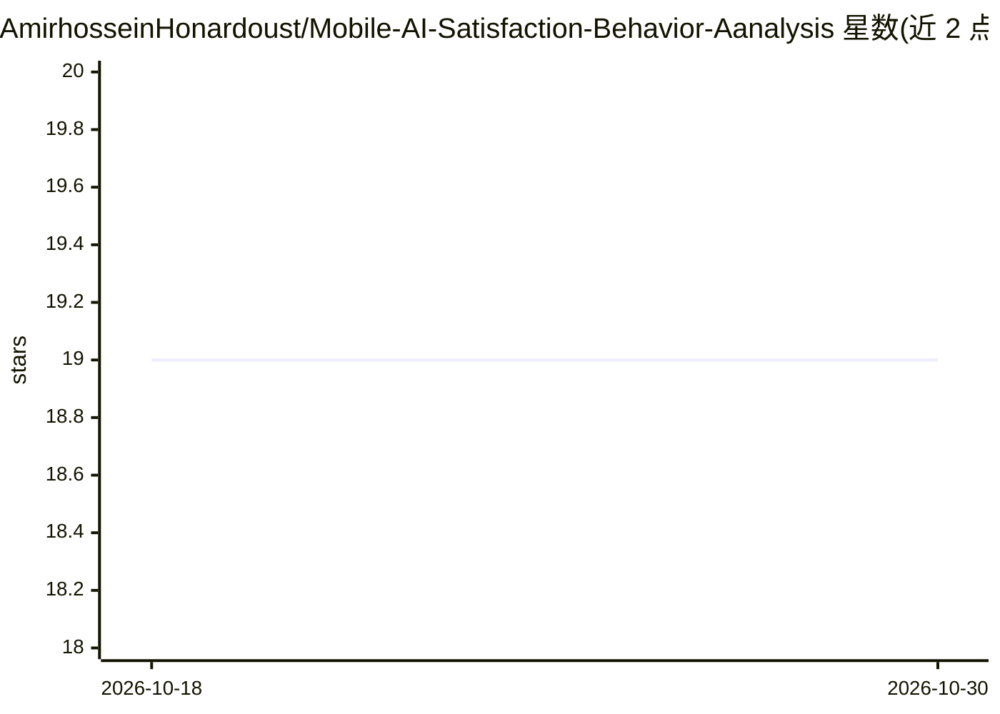

# AmirhosseinHonardoust/Mobile-AI-Satisfaction-Behavior-Aanalysis

⭐ 19 · MIT · 推送 2025-12-07 · [GitHub](https://github.com/AmirhosseinHonardoust/Mobile-AI-Satisfaction-Behavior-Aanalysis) · 个人维护

**解释移动端用户对 AI 满意度更低的研究分析（ML+SHAP）**

基于 300 条 AI 助手交互数据的行为与机器学习分析：训练 RandomForestClassifier（scikit-learn 管线，含 OneHotEncoding、StandardScaler、类别平衡与分层切分），用 SHAP 归因定位设备类型对满意度评分的影响，发现 device_Mobile 具有一致负向贡献。结合认知负荷、交互摩擦、环境压力、任务错配与期望失配等行为学理论解释该现象，并给出按设备自适应的响应与 UI 设计建议。面向人机交互与行为数据研究者，附可复现研究代码与可视化。限制：数据集仅 300 条会话，README 中多处以“你的数据集/你的模型”口吻撰写。

## 筛选速览

| 维度 | 判定 | 备注 |
|---|---|---|
| AI 角色 | `ai-native` | 本体是模型或模型工具 |
| 许可风险 | `permissive` | MIT |
| 部署形态 | `None` |  |
| 模型依赖 | — | README 未给出锁定关系 |
| 硬件要求 | — | 无带数字的原话,不猜 |
| 安装摩擦 | `low` | 无编译、无系统依赖或容器化 |
| 成熟度 | — | 结构信号不足 |

## 能力要点

- RandomForest + SHAP 定位设备类型为满意度的主导负向预测因子
- 认知负荷、交互摩擦、期望失配等多层行为学解释框架
- 移动端对会话时长、提示长度、token 数等交互丰富度指标的抑制效应分析
- 按设备自适应的模型响应与 UI 设计建议

## 适用场景

- 研究设备类型对 AI 用户满意度评分的影响机制
- 为满意度建模引入设备、会话时长等混淆变量
- 为移动端 AI 交互设计提供行为学依据

## 场景标签

`科研工具` `数据分析` · 领域:效率与自动化

## 证据(README 行号)

> L5: Despite identical AI models and identical query content, users interacting through **mobile devices** consistently p
> L78: A RandomForestClassifier is trained inside a scikit-learn pipeline with:
> L84: * SHAP explainability applied to the fitted model

## 星数曲线

2026-10-18 19 → 2026-10-30 19（+0）

---
*卡片 v1 · prompt 1.4 · 生成 2026-10-29 · 置信度 high · 依据 README sha `7a2790d53a3d` · [字段定义](../../DATASET.md)*
