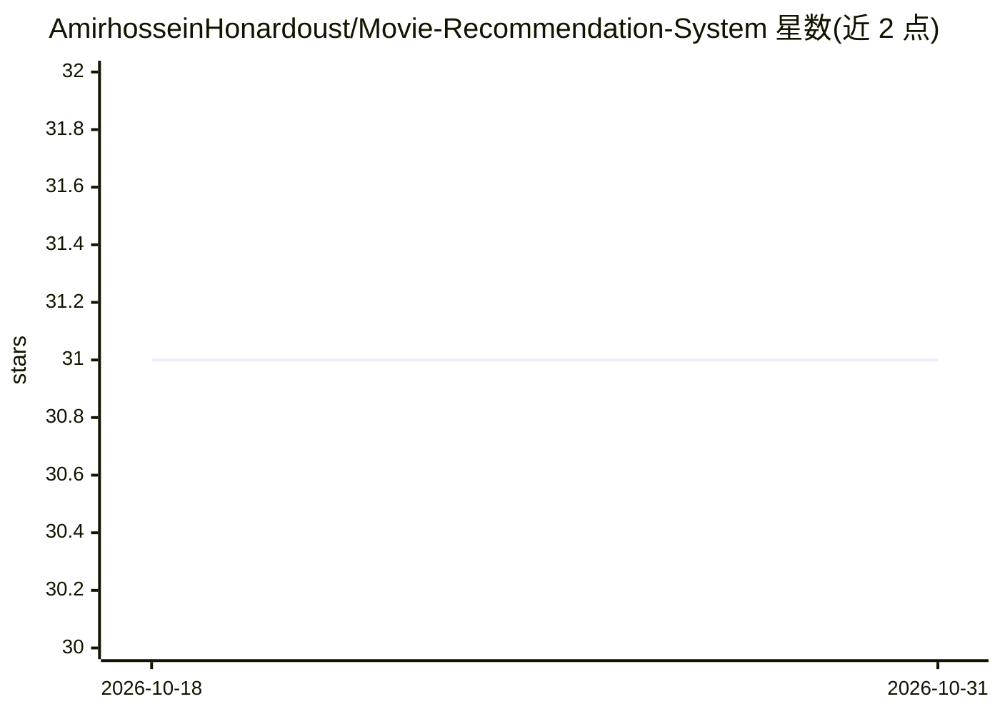

# AmirhosseinHonardoust/Movie-Recommendation-System

⭐ 31 · Python · MIT · 推送 2026-08-22 · [GitHub](https://github.com/AmirhosseinHonardoust/Movie-Recommendation-System) · 个人维护

**组合式电影推荐系统演示：内容/协同/混合三法对比与评估**

面向作品集与研究演示的端到端电影推荐工作流，自述非生产系统。基于确定性种子生成合成电影与评分数据，实现三类推荐：基于类型的 TF-IDF+余弦相似度内容过滤、基于 TruncatedSVD 的协同过滤（用 inverse_transform 重构评分、按用户均值中心化），以及按 alpha 混合两路得分的混合推荐。与五种基线对比，以 Precision@K/Recall@K/NDCG@K/MAP/MRR 评估并做 alpha 扫描，输出结构化 CSV 推荐与可视化报告；附带 MovieLens 本地转换脚本与单元测试、CI。

## 筛选速览

| 维度 | 判定 | 备注 |
|---|---|---|
| AI 角色 | `ai-native` | 本体是模型或模型工具 |
| 许可风险 | `permissive` | MIT |
| 部署形态 | `library` | 以包/库形式分发 |
| 模型依赖 | — | README 未给出锁定关系 |
| 硬件要求 | — | 无带数字的原话,不猜 |
| 安装摩擦 | `low` | 无编译、无系统依赖或容器化 |
| 成熟度 | — | 结构信号不足 |

## 能力要点

- 内容过滤（TF-IDF+余弦相似度）、协同过滤（TruncatedSVD）与 alpha 混合推荐三种方法
- 五种基线对比与 alpha 0.0–1.0 扫描评估
- Precision@K/Recall@K/NDCG@K/MAP/MRR 排序指标与 CSV/文本/图表输出
- 确定性合成数据生成器与 MovieLens 本地转换脚本

## 适用场景

- 学习推荐系统的完整评估工作流（含基线对比与混合权重扫描）
- 作品集展示可复现的推荐系统实验
- 用自有 MovieLens 数据跑通本地转换后复现实验

## 场景标签

`推荐系统` · 领域:学习与行业

## 证据(README 行号)

> L42: - Build a content-based recommender using movie genres
> L43: - Build a collaborative recommender using TruncatedSVD

## 星数曲线

2026-10-18 31 → 2026-10-31 31（+0）

---
*卡片 v1 · prompt 1.4 · 生成 2026-10-26 · 置信度 mid · 依据 README sha `fa40a8dc3976` · [字段定义](../../DATASET.md)*
