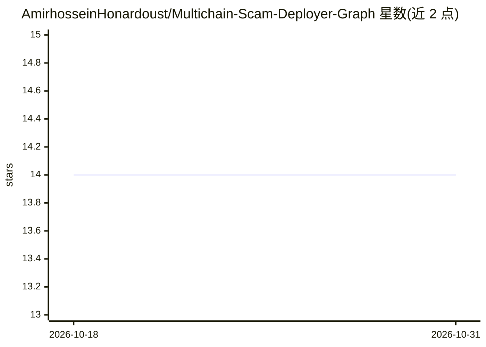

# AmirhosseinHonardoust/Multichain-Scam-Deployer-Graph

⭐ 14 · Python · MIT · 推送 2025-11-24 · [GitHub](https://github.com/AmirhosseinHonardoust/Multichain-Scam-Deployer-Graph) · 个人维护

**跨链恶意合约部署者分析工具：图谱构建+风险评分**

面向区块链安全分析的开源工具包：通过 Etherscan V2 等区块浏览器 API 抓取 Ethereum/BSC/Arbitrum/Base 四链上部署者的交易历史，过滤出合约创建交易，用 NetworkX 构建部署者-合约关系图，计算度、中介中心性等图指标，提取 n_contracts、n_chains 等特征并输出 0-100 启发式风险评分。产出 GEXF 图（可导入 Gephi/Cytoscape）、CSV 节点边表与 ML 就绪特征矩阵，供聚类、异常检测与分类器训练使用。以 pip 依赖的 Python 源码形式提供，需配置各链浏览器 API key。

## 筛选速览

| 维度 | 判定 | 备注 |
|---|---|---|
| AI 角色 | `ai-ecosystem` | LLM/agent 周边工具 |
| 许可风险 | `permissive` | MIT |
| 部署形态 | `library` | 以包/库形式分发 |
| 模型依赖 | — | README 未给出锁定关系 |
| 硬件要求 | — | 无带数字的原话,不猜 |
| 安装摩擦 | `low` | 无编译、无系统依赖或容器化 |
| 成熟度 | — | 结构信号不足 |

## 能力要点

- 覆盖 Ethereum/BSC/Arbitrum/Base 四链的部署者历史抓取（Scan V2 API）
- NetworkX 关系图与 GEXF/CSV 导出，支持 Gephi 可视化
- 节点级图指标与启发式风险评分（0-100，Low/Medium/High）
- 输出 ML 就绪特征矩阵，可用于聚类与分类器训练

## 适用场景

- 追踪同一诈骗者在多条链上的迁移轨迹
- 从单一部署者地址出发梳理整个骗局生态
- 生成部署者信誉画像用于反诈检测
- 用特征 CSV 训练高风险部署者分类模型

## 场景标签

`网络安全` `数据分析` · 领域:效率与自动化

## 证据(README 行号)

> L29: Generating ML-ready datasets to detect high-risk deployers
> L167: Use this file for:
> L171: * training ML models

## 星数曲线

2026-10-18 14 → 2026-10-31 14（+0）

---
*卡片 v1 · prompt 1.4 · 生成 2026-10-31 · 置信度 mid · 依据 README sha `cb0ebb03d318` · [字段定义](../../DATASET.md)*
