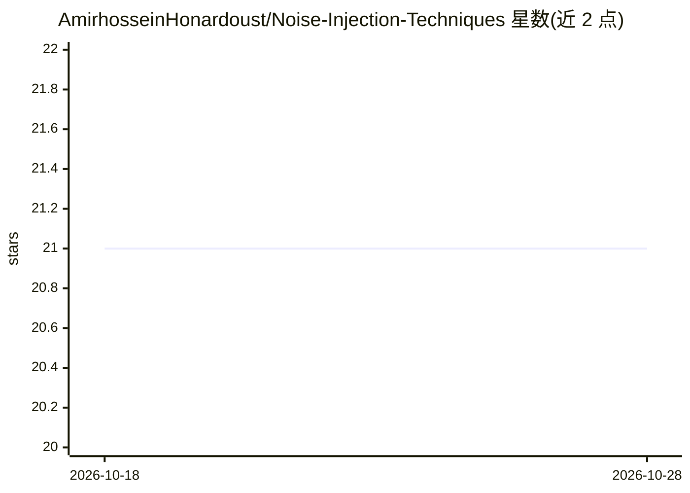

# AmirhosseinHonardoust/Noise-Injection-Techniques

⭐ 21 · MIT · 推送 2025-11-15 · [GitHub](https://github.com/AmirhosseinHonardoust/Noise-Injection-Techniques) · 个人维护

**面向数据科学家的噪声注入技术教程：讲解原理、代码与适用场景**

一篇长文式指南，讲解通过噪声注入提升机器学习模型对脏数据鲁棒性的方法：覆盖高斯噪声、Dropout、标签平滑、Mixup、随机遮罩与对抗噪声（FGSM/PGD）六类技术，逐一给出直觉解释、数学原理（噪声等价于正则化）、PyTorch 代码片段与适用场景对照表。还包含假设性实验结果、噪声何时有害的边界条件与最佳实践。面向数据科学家、ML 工程师与研究人员；以文章形式呈现，非可安装的库。

## 筛选速览

| 维度 | 判定 | 备注 |
|---|---|---|
| AI 角色 | `ai-knowledge` | 知识聚合/清单类 |
| 许可风险 | `permissive` | MIT |
| 部署形态 | `None` |  |
| 模型依赖 | — | README 未给出锁定关系 |
| 硬件要求 | — | 无带数字的原话,不猜 |
| 安装摩擦 | `low` | 无编译、无系统依赖或容器化 |
| 成熟度 | — | 结构信号不足 |

## 能力要点

- 六类噪声注入技术的直觉、数学与 PyTorch 代码示例
- 噪声等价于正则化的数学解释
- 按问题类型（表格/回归/分类/对抗环境）的技术选择对照表
- 噪声注入失效场景与最佳实践清单

## 适用场景

- 训练前了解哪些噪声注入技术适合我的数据类型
- 为部署在脏数据环境的模型选择鲁棒化方法
- 学习 Mixup、对抗噪声等技术的 PyTorch 实现

## 场景标签

`教程课程` · 领域:学习与行业

## 证据(README 行号)

> L3: *An in-depth guide for data scientists, ML engineers, and researchers*
> L31: This article walks through:

## 星数曲线

2026-10-18 21 → 2026-10-28 21（+0）

---
*卡片 v1 · prompt 1.4 · 生成 2026-10-28 · 置信度 high · 依据 README sha `b1492e2a1975` · [字段定义](../../DATASET.md)*
