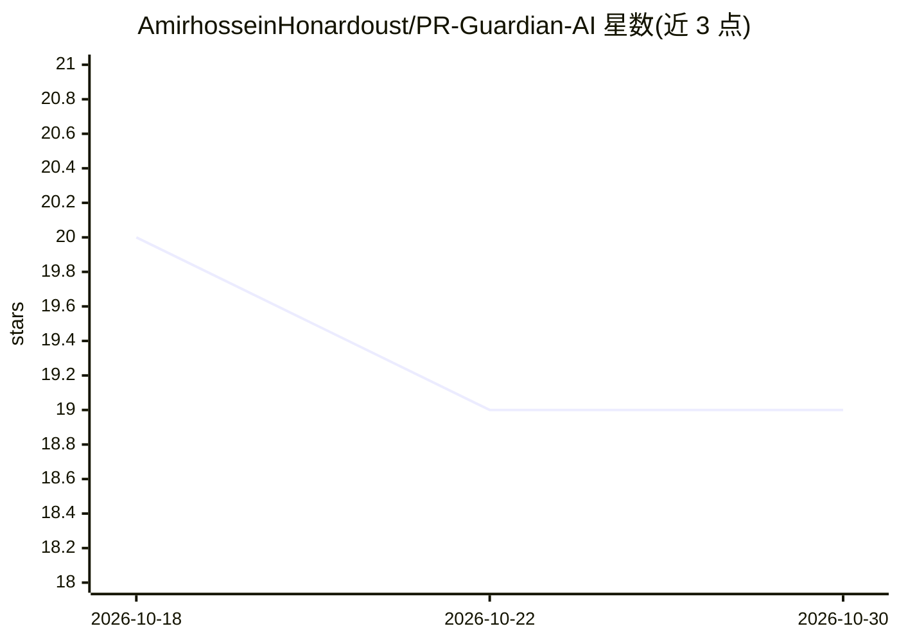

# AmirhosseinHonardoust/PR-Guardian-AI

⭐ 19 · Python · MIT · 推送 2025-12-06 · [GitHub](https://github.com/AmirhosseinHonardoust/PR-Guardian-AI) · 个人维护

**自动审查 GitHub Pull Request 并在 PR 内写评论的 AI 应用**

以 GitHub App + FastAPI 后端形式运行的 PR 自动审查工具：接收 pull_request webhook，校验签名后以 JWT 与 installation token 认证为 GitHub App，拉取 PR diff，发送给 OpenAI 做结构化分析（bug、性能、命名、安全），再通过 GitHub API 在 PR 会话中发评论。面向希望减少人工审查工作量的开发团队；运行需配置 GitHub App 凭据与 OPENAI_API_KEY，本地开发可搭配 Smee.io 做 webhook 转发，可部署到 Railway/Render/VPS 等平台。

## 筛选速览

| 维度 | 判定 | 备注 |
|---|---|---|
| AI 角色 | `ai-native` | 本体是模型或模型工具 |
| 许可风险 | `permissive` | MIT |
| 部署形态 | `library` | 以包/库形式分发 |
| 模型依赖 | — | README 未给出锁定关系 |
| 硬件要求 | — | 无带数字的原话,不猜 |
| 安装摩擦 | `low` | 无编译、无系统依赖或容器化 |
| 成熟度 | — | 结构信号不足 |

## 能力要点

- webhook 实时处理 PR opened/synchronize 事件
- AI 分析 diff 中的 bug、安全风险、性能与命名问题
- 以 GitHub App 身份（JWT + installation token）在 PR 内发评论
- 列出 Railway/Render/DigitalOcean/Heroku/VPS 等部署选项

## 适用场景

- 团队在 PR 中自动获得代码问题与安全风险评论
- 减少重复性人工审查工作量并获得一致反馈
- 本地用 Smee.io 转发 webhook 调试自己的 AI 审查服务

## 场景标签

`代码审查` · 领域:编码与开发

## 证据(README 行号)

> L9: **PR Guardian AI** is an advanced GitHub App that automatically reviews pull requests using artificial intelligence.
> L71: It sends diff to OpenAI with a structured prompt:

## 星数曲线

2026-10-18 20 → 2026-10-30 19（-1）

---
*卡片 v1 · prompt 1.4 · 生成 2026-10-29 · 置信度 mid · 依据 README sha `3511dbcab40b` · [字段定义](../../DATASET.md)*
