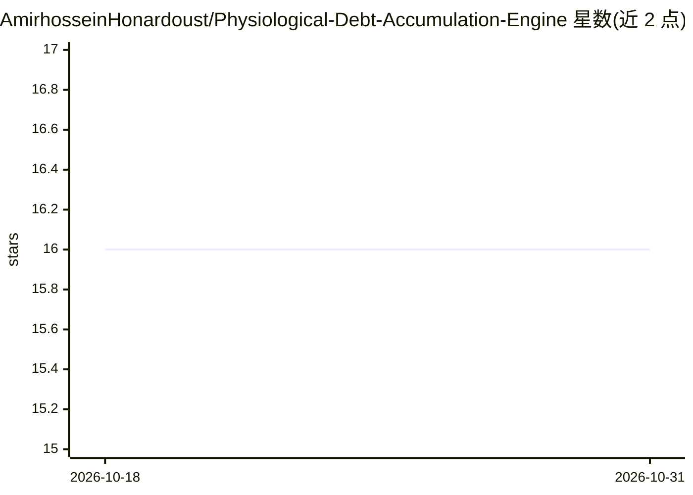

# AmirhosseinHonardoust/Physiological-Debt-Accumulation-Engine

⭐ 16 · Python · MIT · 推送 2025-12-19 · [GitHub](https://github.com/AmirhosseinHonardoust/Physiological-Debt-Accumulation-Engine) · 个人维护

**睡眠恢复债建模引擎：量化生理压力积累与隐性脆弱性**

面向研究者与教育场景的系统级分析引擎：将睡眠建模为'需求恢复—实际恢复'之间的债务过程，而非单夜结果。基于生理特征（体重、脑重的对数缩放等）与生态压力信号估计预测睡眠需求量，计算累计睡眠债，并划分 Stable/Accumulating/Critical 三种状态区间；提供贡献分解、反事实压力情景模拟、人群级债务分布图与数据集浏览视图。README 明确声明不用于医疗诊断或处方建议，仅作研究探索、系统思维与领先指标分析。

## 筛选速览

| 维度 | 判定 | 备注 |
|---|---|---|
| AI 角色 | `ai-native` | 本体是模型或模型工具 |
| 许可风险 | `permissive` | MIT |
| 部署形态 | `None` |  |
| 模型依赖 | — | README 未给出锁定关系 |
| 硬件要求 | — | 无带数字的原话,不猜 |
| 安装摩擦 | `low` | 无编译、无系统依赖或容器化 |
| 成熟度 | — | 结构信号不足 |

## 能力要点

- 将睡眠债定义为累计、方向性的未支付恢复量并做区间分类
- 贡献分解视图展示各因素对预测睡眠需求的正负贡献
- 反事实压力模拟揭示潜在脆弱性（不做时间点预测）
- 数据集浏览视图支持审计与重新解读

## 适用场景

- 研究压力积累与延迟性衰竭之间的系统关系
- 分析个体睡眠债在人群压力场中的相对位置
- 作为睡眠系统思维的教学演示材料

## 场景标签

 · 领域:健康/生理数据分析

## 证据(README 行号)

> L106: Predicted sleep need is the model’s estimate of:
> L281: * Research exploration
> L284: * Educational demonstrations

## 星数曲线

2026-10-18 16 → 2026-10-31 16（+0）

---
*卡片 v1 · prompt 1.4 · 生成 2026-10-30 · 置信度 mid · 依据 README sha `7ffbee801a1f` · [字段定义](../../DATASET.md)*
