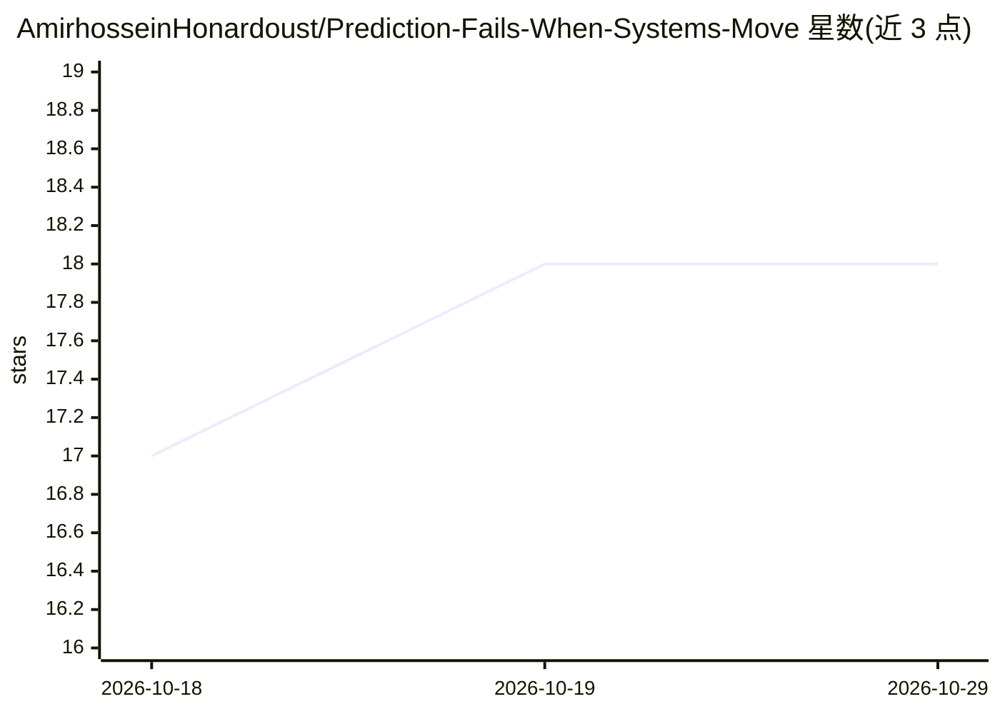

# AmirhosseinHonardoust/Prediction-Fails-When-Systems-Move

⭐ 18 · MIT · 推送 2025-12-13 · [GitHub](https://github.com/AmirhosseinHonardoust/Prediction-Fails-When-Systems-Move) · 个人维护

**分析性文章：论述预测模型在反身性系统中的失效**

一篇机器学习哲学方向的分析性长文，不是软件项目，无安装或运行方式。文章论证：当模型影响被建模系统的行为（反身性）时，预测准确性会结构性地失效；引用索罗斯的反身性概念说明预测自我失效的反馈循环。作者提出以均衡与力（压力、激励、适应成本）为基础的建模框架替代基于特征的模式预测，主张产出区间而非点预测，并认为可解释性应内建于模型架构，伦理问题在于不确定性由谁承担。

## 筛选速览

| 维度 | 判定 | 备注 |
|---|---|---|
| AI 角色 | `ai-knowledge` | 知识聚合/清单类 |
| 许可风险 | `permissive` | MIT |
| 部署形态 | `None` |  |
| 模型依赖 | — | README 未给出锁定关系 |
| 硬件要求 | — | 无带数字的原话,不猜 |
| 安装摩擦 | `low` | 无编译、无系统依赖或容器化 |
| 成熟度 | — | 结构信号不足 |

## 能力要点

- 论证反身性系统中预测准确性的自我失效机制
- 提出力与均衡建模框架：关注压力与方向而非历史状态
- 主张区间输出与构造性可解释（每个结果是压力之和）
- 讨论黑箱预测系统的伦理责任问题

## 适用场景

- 理解机器学习在人类系统中的方法论局限
- 为 AI 系统设计中的不确定性沟通与伦理讨论提供论点素材
- 研究反身性与反馈循环对预测模型的影响

## 场景标签

 · 领域:机器学习哲学/方法论

## 证据(README 行号)

> L1: # **Prediction Fails When Systems Move, Equilibrium Explains Why**
> L269: > **Prediction fails when systems move because it assumes continuity where adaptation dominates.

## 星数曲线

2026-10-18 17 → 2026-10-29 18（+1）

---
*卡片 v1 · prompt 1.4 · 生成 2026-10-29 · 置信度 high · 依据 README sha `58c1d11fd04c` · [字段定义](../../DATASET.md)*
