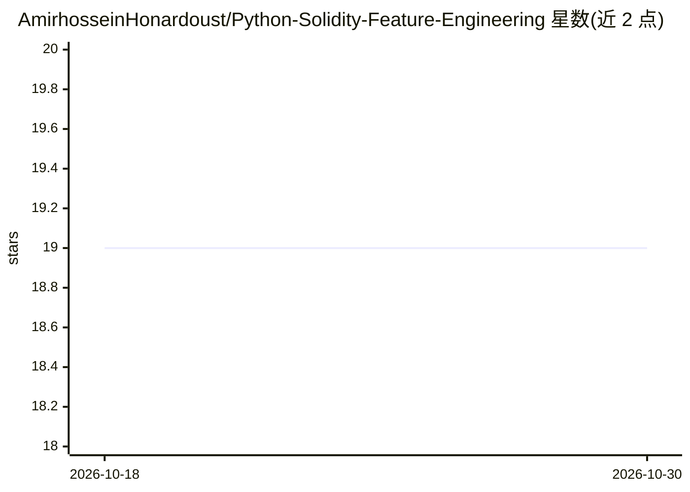

# AmirhosseinHonardoust/Python-Solidity-Feature-Engineering

⭐ 19 · MIT · 推送 2025-11-15 · [GitHub](https://github.com/AmirhosseinHonardoust/Python-Solidity-Feature-Engineering) · 个人维护

**用 Python 对 Solidity 合约做特征提取与风险评分的工具包**

面向研究与教学的静态分析工具包：用正则从 Solidity 源码中提取危险操作码（delegatecall、tx.origin、selfdestruct 等）与攻击面指标（payable/public 函数数、行数），经启发式规则输出风险评分与风险等级，并以 SHA256 哈希提供源码指纹用于追溯。附带 CLI 可对单个 .sol 文件运行生成 JSON 报告。README 还给出用 RandomForest 训练风险分类模型与迁移到 Slither/AST 解析的后续路径。定位为轻量特征工程基础，非完整审计器。

## 筛选速览

| 维度 | 判定 | 备注 |
|---|---|---|
| AI 角色 | `ai-native` | 本体是模型或模型工具 |
| 许可风险 | `permissive` | MIT |
| 部署形态 | `None` |  |
| 模型依赖 | — | README 未给出锁定关系 |
| 硬件要求 | — | 无带数字的原话,不猜 |
| 安装摩擦 | `low` | 无编译、无系统依赖或容器化 |
| 成熟度 | — | 结构信号不足 |

## 能力要点

- 正则提取危险操作码与攻击面特征（delegatecall/tx.origin/selfdestruct 等）
- 启发式风险评分引擎输出 risk_score 与 risk_level 分级
- SHA256 源码哈希指纹支持分析与版本追踪
- CLI 一条命令对 .sol 文件输出 JSON 分析结果

## 适用场景

- 在部署前快速筛查智能合约中的危险模式
- 为区块链安全机器学习研究构建标注数据集与特征
- 作为教学材料学习 Solidity 静态分析与特征工程

## 场景标签

`网络安全` · 领域:学习与行业

## 证据(README 行号)

> L10: This is not about building a full auditor. Instead, it’s about understanding **how Python can learn to “read” Solid
> L206:    RandomForestClassifier().fit(X, y)

## 星数曲线

2026-10-18 19 → 2026-10-30 19（+0）

---
*卡片 v1 · prompt 1.4 · 生成 2026-10-29 · 置信度 high · 依据 README sha `b80d75f2aeb0` · [字段定义](../../DATASET.md)*
