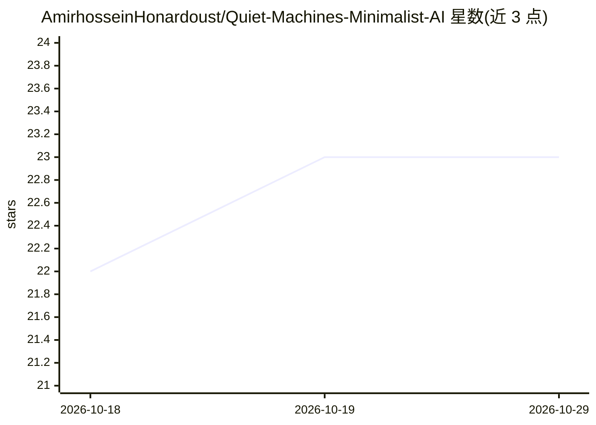

# AmirhosseinHonardoust/Quiet-Machines-Minimalist-AI

⭐ 23 · MIT · 推送 2025-11-02 · [GitHub](https://github.com/AmirhosseinHonardoust/Quiet-Machines-Minimalist-AI) · 个人维护

**关于极简主义 AI 哲学的长文：安静、克制的技术理念**

一篇探讨极简主义 AI 哲学的长篇论述，提出"Quiet Machines"概念：智能系统应安静、合乎伦理且隐形，倾听多于言说。文章梳理 Mark Weiser 的普适计算与 calm technology 传统，引述 Cal Newport、John Maeda、Dieter Rams 等设计文献，阐述边缘计算、联邦学习、自适应阈值等技术路径，并给出五条设计宣言。属于思想性文章，不提供可运行的代码或工具。

## 筛选速览

| 维度 | 判定 | 备注 |
|---|---|---|
| AI 角色 | `ai-knowledge` | 知识聚合/清单类 |
| 许可风险 | `permissive` | MIT |
| 部署形态 | `None` |  |
| 模型依赖 | — | README 未给出锁定关系 |
| 硬件要求 | — | 无带数字的原话,不猜 |
| 安装摩擦 | `low` | 无编译、无系统依赖或容器化 |
| 成熟度 | — | 结构信号不足 |

## 能力要点

- 梳理 calm technology 谱系（Weiser、Amber Case）并引述 10 部参考文献
- 提出 Quiet AI 的三原则与五条设计宣言
- 讨论边缘推理、联邦学习、自适应阈值等技术实现路径

## 适用场景

- 了解极简主义 AI 与 calm technology 的设计哲学
- 为 AI 产品设计收集注意力伦理相关论述与文献线索
- 作为技术伦理课程的讨论材料

## 场景标签

 · 领域:AI 伦理/技术评论

## 证据(README 行号)

> L1: # Quiet Machines: The Future of Minimalist AI
> L138: ## References & Further Reading

## 星数曲线

2026-10-18 22 → 2026-10-29 23（+1）

---
*卡片 v1 · prompt 1.4 · 生成 2026-10-27 · 置信度 high · 依据 README sha `a91a7575d3dd` · [字段定义](../../DATASET.md)*
