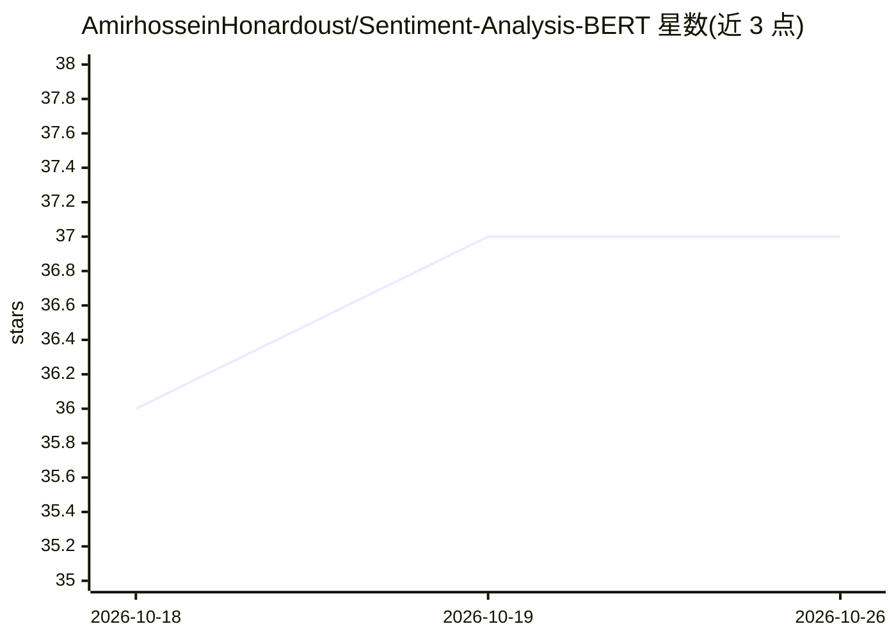

# AmirhosseinHonardoust/Sentiment-Analysis-BERT

⭐ 37 · Python · MIT · 推送 2026-09-09 · [GitHub](https://github.com/AmirhosseinHonardoust/Sentiment-Analysis-BERT) · 个人维护

**基于 BERT 微调的推文情感分析端到端流水线**

面向 NLP 开发者的文本分类工程示例：对推文做清洗、分词与 train/val/test 划分，微调 bert-base-uncased 完成负面/中性/正面三分类，并配套无预训练权重的 BiLSTM 基线，两模型经同一 evaluate.py 入口评估。产出分类报告、混淆矩阵、ROC 曲线、词云与训练曲线，predict.py 支持单条/多条文本推理。内置约 15 行演示数据，仓库中指标仅验证流程可跑通而非真实性能；测试套件用微型本地 BERT 检查点离线运行。

## 筛选速览

| 维度 | 判定 | 备注 |
|---|---|---|
| AI 角色 | `ai-native` | 本体是模型或模型工具 |
| 许可风险 | `permissive` | MIT |
| 部署形态 | `library` | 以包/库形式分发 |
| 模型依赖 | — | README 未给出锁定关系 |
| 硬件要求 | — | 无带数字的原话,不猜 |
| 安装摩擦 | `low` | 无编译、无系统依赖或容器化 |
| 成熟度 | — | 结构信号不足 |

## 能力要点

- 微调 bert-base-uncased 做三分类，附 BiLSTM 基线对比
- 统一评估入口自动识别 BERT/LSTM 检查点类型
- 生成分类报告、混淆矩阵、ROC 曲线、词云与训练曲线
- CI 离线测试套件（随机初始化微型 BERT 检查点，无需网络下载）

## 适用场景

- 学习模块化、可复现的 transformer 微调工作流
- 替换为自有 text,label 数据集做情感分类训练与评估
- 作为作品集展示 NLP 工程实践（测试、CI、代码规范）

## 场景标签

`微调` · 领域:训练与推理

## 证据(README 行号)

> L10: A deep learning project for **sentiment classification of tweets**, built around fine-tuning **BERT (`bert-base-unc
> L29: - Fine-tune `bert-base-uncased` on sentiment labels

## 星数曲线

2026-10-18 36 → 2026-10-26 37（+1）

---
*卡片 v1 · prompt 1.4 · 生成 2026-10-25 · 置信度 high · 依据 README sha `345c842c613a` · [字段定义](../../DATASET.md)*
