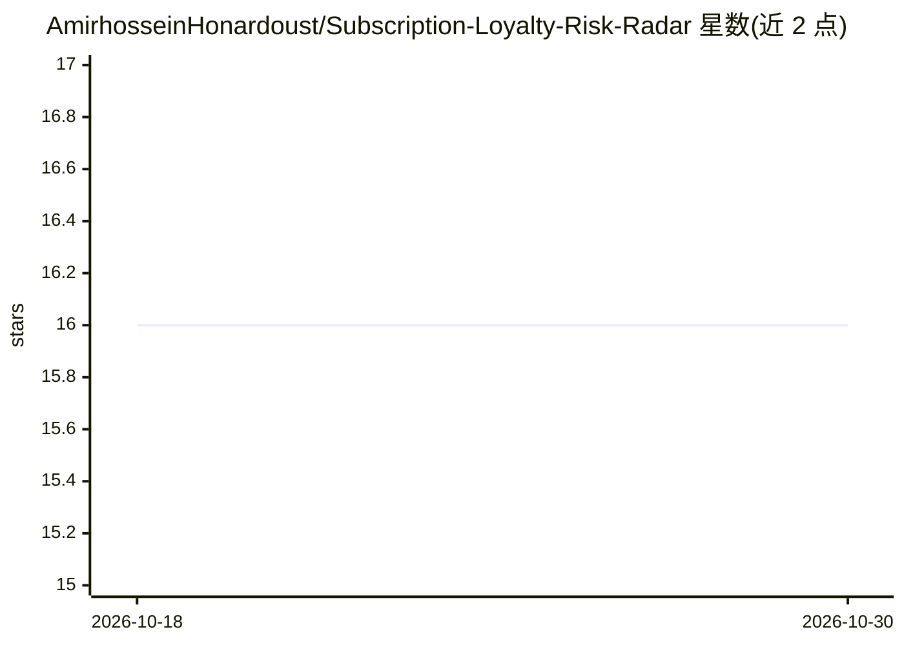

# AmirhosseinHonardoust/Subscription-Loyalty-Risk-Radar

⭐ 16 · Python · MIT · 推送 2025-12-08 · [GitHub](https://github.com/AmirhosseinHonardoust/Subscription-Loyalty-Risk-Radar) · 个人维护

**电商客户智能引擎：预测订阅概率、购买频率并计算忠诚度风险分**

基于 Random Forest 的全栈 ML 系统：订阅概率分类模型、购买频率回归模型（强度 1–7），加权合成 Loyalty Index 与 0–100 风险分；提供全局与单客户的特征解释、客群洞察、what-if 场景模拟（修改物流/折扣/促销等属性后重算各指标差值），通过 Streamlit 交互仪表盘交付。输入购物行为与人口统计数据，经 CLI 完成 prepare/train/evaluate/score 流程。Docker 与 FastAPI 部署列为未来计划，当前未见实现。

## 筛选速览

| 维度 | 判定 | 备注 |
|---|---|---|
| AI 角色 | `ai-native` | 本体是模型或模型工具 |
| 许可风险 | `permissive` | MIT |
| 部署形态 | `library` | 以包/库形式分发 |
| 模型依赖 | — | README 未给出锁定关系 |
| 硬件要求 | — | 无带数字的原话,不猜 |
| 安装摩擦 | `low` | 无编译、无系统依赖或容器化 |
| 成熟度 | — | 结构信号不足 |

## 能力要点

- 订阅概率 + 购买频率双模型合成 0–100 忠诚度风险分
- 全局与单客户级特征解释
- what-if 场景模拟并输出各指标差值
- Streamlit 交互仪表盘与 CLI 训练/评分流程

## 适用场景

- 电商团队识别流失风险客户并定位原因
- 营销/产品团队测试折扣、物流等策略对忠诚度的影响
- 按客群生成个性化营销与留存洞察

## 场景标签

`数据分析` · 领域:效率与自动化

## 证据(README 行号)

> L21: ### 1. Predicts **subscription probability**
> L29: ### 3. Creates a unified **Loyalty Risk Score (0–100)**
> L212: Loyalty = Intent (60%) + Behavior (40%)

## 星数曲线

2026-10-18 16 → 2026-10-30 16（+0）

---
*卡片 v1 · prompt 1.4 · 生成 2026-10-30 · 置信度 high · 依据 README sha `7a3be575de4e` · [字段定义](../../DATASET.md)*
