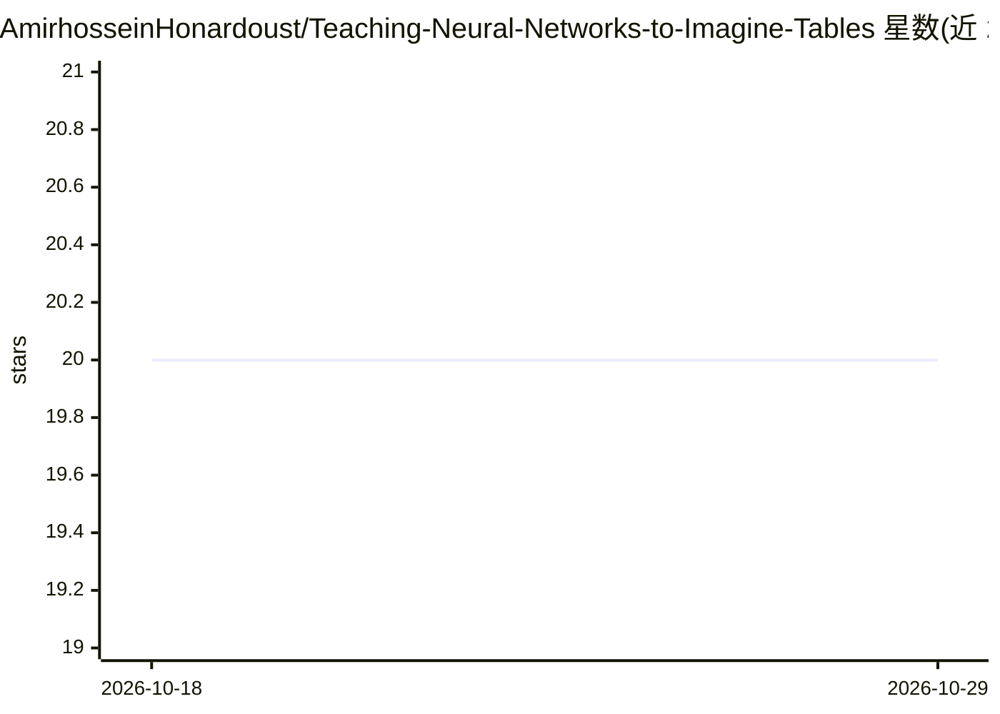

# AmirhosseinHonardoust/Teaching-Neural-Networks-to-Imagine-Tables

⭐ 20 · MIT · 推送 2025-11-10 · [GitHub](https://github.com/AmirhosseinHonardoust/Teaching-Neural-Networks-to-Imagine-Tables) · 个人维护

**教程文章：用 VAE 生成合成表格数据的原理与实现**

一篇讲解型长文（含代码片段），阐述变分自编码器（VAE）如何学习表格数据的潜在分布并生成统计性质相近的合成样本。内容覆盖表格数据对生成模型的挑战、编码器-潜空间-解码器结构与重参数化技巧、PyTorch 实现三步（数据预处理、模型定义、训练与采样）、以 JSD/相关性热图/PCA 投影评估合成质量、与高斯 Copula 的对比，并列出局限性（高基数类别变量表现差、难施加语义约束）与应用方向（隐私共享、数据增强、仿真）。

## 筛选速览

| 维度 | 判定 | 备注 |
|---|---|---|
| AI 角色 | `ai-knowledge` | 知识聚合/清单类 |
| 许可风险 | `permissive` | MIT |
| 部署形态 | `None` |  |
| 模型依赖 | — | README 未给出锁定关系 |
| 硬件要求 | — | 无带数字的原话,不猜 |
| 安装摩擦 | `low` | 无编译、无系统依赖或容器化 |
| 成熟度 | — | 结构信号不足 |

## 能力要点

- 讲解 VAE 编码器-潜空间-解码器结构与重参数化技巧
- 给出 PyTorch 实现与采样合成数据的代码步骤
- 以 JSD、相关性热图、PCA 投影等指标评估合成数据质量
- 与高斯 Copula 做逐项对比并声明各自适用面

## 适用场景

- 学习如何用深度生成模型合成表格数据
- 为隐私保护的数据共享与数据增强寻找方法参考
- 理解 VAE 在结构化数据上的能力与局限

## 场景标签

`教程课程` · 领域:学习与行业

## 证据(README 行号)

> L1: # Teaching Neural Networks to Imagine Tables: Inside VAE for Tabular Data
> L9: This article explores **how a Variational Autoencoder (VAE)** learns to “dream” in structured data: capturing its pa
> L53: ## Implementing a VAE for Tabular Data

## 星数曲线

2026-10-18 20 → 2026-10-29 20（+0）

---
*卡片 v1 · prompt 1.4 · 生成 2026-10-28 · 置信度 high · 依据 README sha `6ffe53b92c7d` · [字段定义](../../DATASET.md)*
