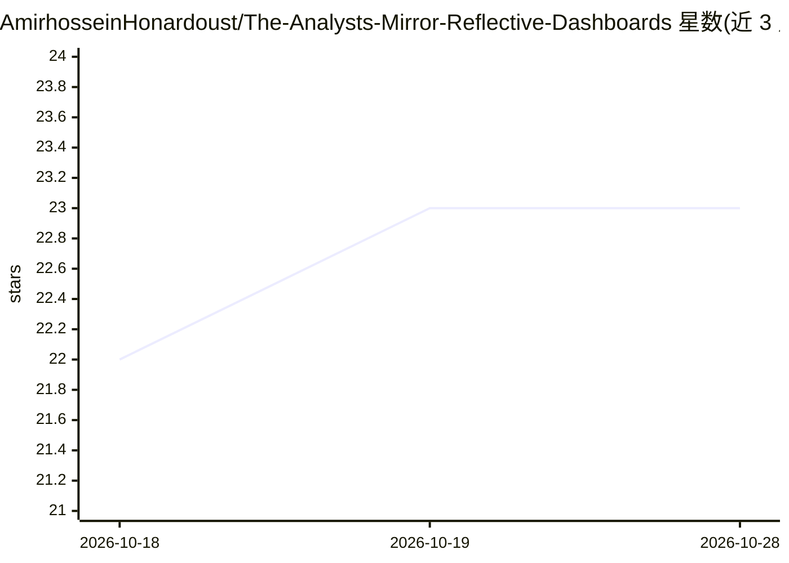

# AmirhosseinHonardoust/The-Analysts-Mirror-Reflective-Dashboards

⭐ 23 · MIT · 推送 2025-11-05 · [GitHub](https://github.com/AmirhosseinHonardoust/The-Analysts-Mirror-Reflective-Dashboards) · 个人维护

**概念文章：提出从用户行为学习并自适应的分析型仪表盘**

一篇阐述“反思式分析（Reflective Analytics）”概念的设计文章，不含可运行代码。提出在传统 BI 之上加行为学习层：记录筛选序列、停留时长等交互数据，经聚类或强化学习建模分析习惯，再由推荐引擎动态调整仪表盘布局与叙事摘要（LLM 为可选层），并通过用户反馈闭环迭代。含分层架构图、实现蓝图示意与伦理透明性讨论（查看/清除行为日志）。给数据分析师、BI 设计者与交互研究者阅读。

## 筛选速览

| 维度 | 判定 | 备注 |
|---|---|---|
| AI 角色 | `ai-knowledge` | 知识聚合/清单类 |
| 许可风险 | `permissive` | MIT |
| 部署形态 | `None` |  |
| 模型依赖 | — | README 未给出锁定关系 |
| 硬件要求 | — | 无带数字的原话,不猜 |
| 安装摩擦 | `low` | 无编译、无系统依赖或容器化 |
| 成熟度 | — | 结构信号不足 |

## 能力要点

- 五层反思架构：交互日志→行为建模→自适应推荐→动态布局→反馈闭环
- 聚类/强化学习检测分析模式，LLM 叙事生成为可选层
- 伦理章节要求行为日志可查看、可清除、推荐可解释

## 适用场景

- 作为自适应 BI / 人在环分析系统的设计参考
- 研究仪表盘个性化与行为建模的架构思路
- 了解行为数据驱动的分析界面伦理与透明性要求

## 场景标签

 · 领域:商业智能/数据可视化

## 证据(README 行号)

> L48: A reflective system introduces a *behavioral learning layer* on top of the traditional BI stack.
> L67: |**Narrative Generator**|Converts findings into text-based summaries (LLM-powered optional layer).|

## 星数曲线

2026-10-18 22 → 2026-10-28 23（+1）

---
*卡片 v1 · prompt 1.4 · 生成 2026-10-27 · 置信度 mid · 依据 README sha `37ff9dbdb47d` · [字段定义](../../DATASET.md)*
