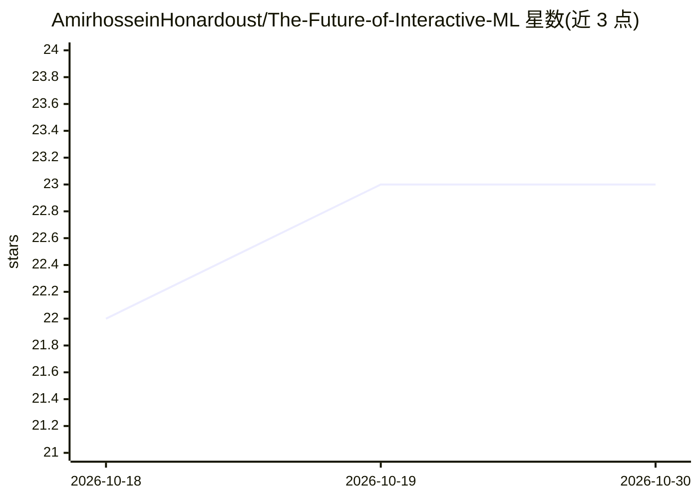

# AmirhosseinHonardoust/The-Future-of-Interactive-ML

⭐ — · [GitHub]() · 个人维护

**探讨以人为中心的交互式机器学习的长文（Streamlit 案例分析）**

一篇关于以人为中心的交互式机器学习的研究型文章，阐述 Streamlit 如何让数据科学家以 Python 脚本方式构建交互式 ML 界面。内容涵盖 HCAI 理论（引用 Shneiderman 宣言与微软 HAI 指南）、以 ML Playground 项目为案例的架构说明（自动任务检测、预处理流水线、模型训练与可视化指标）以及对可解释性与民主化 AI 趋势的讨论。仓库为文章本体，不提供可运行代码或安装命令，仅含示例代码片段与参考文献。

## 筛选速览

| 维度 | 判定 | 备注 |
|---|---|---|
| AI 角色 | `ai-knowledge` | 知识聚合/清单类 |
| 许可风险 | `permissive` | — |
| 部署形态 | `None` |  |
| 模型依赖 | — | README 未给出锁定关系 |
| 硬件要求 | — | 无带数字的原话,不猜 |
| 安装摩擦 | `low` | 无编译、无系统依赖或容器化 |
| 成熟度 | — | 结构信号不足 |

## 能力要点

- 以 ML Playground 为案例说明 Streamlit 构建自适应 ML 环境（自动任务检测、流水线、指标可视化）
- 梳理 HCAI 理论与设计原则（透明、可控、人在回路）
- 含 8 条带注释的参考文献与引用来源

## 适用场景

- 了解以人为中心的 AI 与交互式机器学习的理论脉络
- 参考用 Streamlit 构建 ML 应用界面的设计思路
- 查找 HCAI 方向的延伸阅读文献

## 场景标签

`教程课程` · 领域:学习与行业

## 证据(README 行号)

> L3: An in-depth exploration of the rise of human-centered, interactive machine learning. This article examines how Strea
> L5: ## Abstract

## 星数曲线

2026-10-18 22 → 2026-10-30 23（+1）

---
*卡片 v1 · prompt 1.4 · 生成 2026-10-27 · 置信度 high · 依据 README sha `d776cb9683ca` · [字段定义](../../DATASET.md)*
