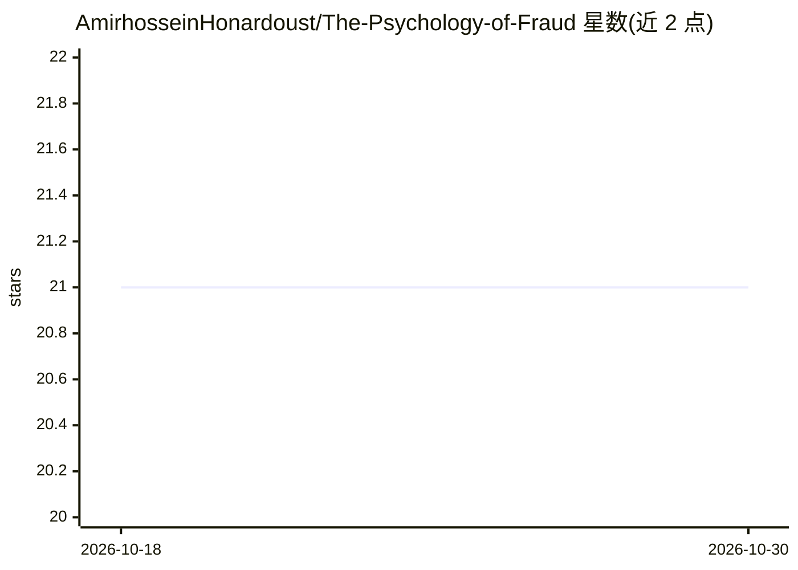

# AmirhosseinHonardoust/The-Psychology-of-Fraud

⭐ 21 · MIT · 推送 2025-12-04 · [GitHub](https://github.com/AmirhosseinHonardoust/The-Psychology-of-Fraud) · 个人维护

**欺诈心理与交易行为信号的长文知识库**

由个人维护的英文长文（非代码库），系统阐述欺诈者的认知心理、行为经济学、认知负荷与身份连续性如何转化为交易数据中的可测信号，覆盖金额阶梯模式、商户类别、设备指纹、IP 风险、速度特征、欺诈序列阶段与行为漂变，并解释 RandomForest、逻辑回归、SHAP、图网络、Transformer 等模型如何将这些行为特征数学化。面向反欺诈分析者与数据科学学习者。无代码、无安装方式，内容为单篇 README 文章。

## 筛选速览

| 维度 | 判定 | 备注 |
|---|---|---|
| AI 角色 | `ai-knowledge` | 知识聚合/清单类 |
| 许可风险 | `permissive` | MIT |
| 部署形态 | `None` |  |
| 模型依赖 | — | README 未给出锁定关系 |
| 硬件要求 | — | 无带数字的原话,不猜 |
| 安装摩擦 | `low` | 无编译、无系统依赖或容器化 |
| 成熟度 | — | 结构信号不足 |

## 能力要点

- 四层框架：认知心理→行为模式→数字足迹→ML 特征
- 欺诈五阶段序列建模（Preparation→Shutdown）
- 解读多种 ML 模型如何刻画欺诈行为特征

## 适用场景

- 反欺诈建模前的行为特征设计参考
- 理解欺诈者心理机制与可检测信号
- 作为行为科学与 ML 结合的学习材料

## 场景标签

`教程课程` · 领域:学习与行业

## 证据(README 行号)

> L28: We will explore fraud on four interconnected layers:
> L44: How metadata becomes predictive variables inside a fraud model.
> L470: Fraud psychology → transaction metadata → ML features → predictions → fraud prevention.

## 星数曲线

2026-10-18 21 → 2026-10-30 21（+0）

---
*卡片 v1 · prompt 1.4 · 生成 2026-10-28 · 置信度 high · 依据 README sha `6bbdc3fbaa69` · [字段定义](../../DATASET.md)*
