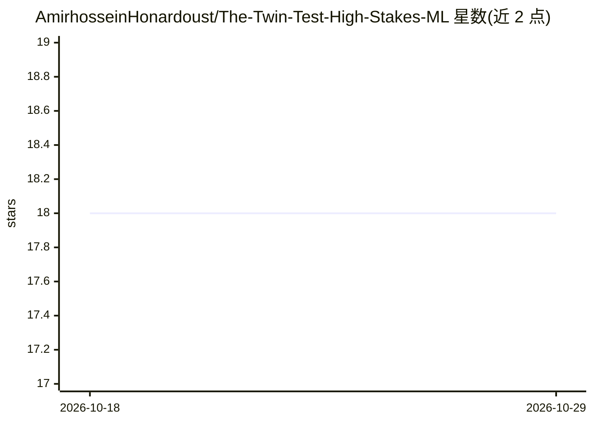

# AmirhosseinHonardoust/The-Twin-Test-High-Stakes-ML

⭐ 18 · MIT · 推送 2025-12-26 · [GitHub](https://github.com/AmirhosseinHonardoust/The-Twin-Test-High-Stakes-ML) · 个人维护

**提出 Twin Test 的长文：高风险 ML 需展示相似案例证据**

一篇长篇文章（无代码/库/数据），提出面向高风险机器学习部署的“Twin Test”检查清单：要求模型输出最近邻“孪生”案例、邻域紧致度距离曲线、混合/同质证据标注、局部驱动特征，并在无近邻时显式弃权，配套升级策略（人工复核/弃权/降低干预强度）。文章论证相似性证据包优于单一概率分数，并讨论漂移、偏差可见性、反事实解释伦理、隐私约束与四类失效模式及缓解手段。属于理念/方法论文章，不提供可安装实现。

## 筛选速览

| 维度 | 判定 | 备注 |
|---|---|---|
| AI 角色 | `ai-knowledge` | 知识聚合/清单类 |
| 许可风险 | `permissive` | MIT |
| 部署形态 | `None` |  |
| 模型依赖 | — | README 未给出锁定关系 |
| 硬件要求 | — | 无带数字的原话,不猜 |
| 安装摩擦 | `low` | 无编译、无系统依赖或容器化 |
| 成熟度 | — | 结构信号不足 |

## 能力要点

- 6 项 Twin Test 检查清单：孪生案例、距离曲线、证据纯度、驱动特征、无孪生态、升级规则
- “不确定性是位置而非数字”：稠密/边界/稀疏三区域框架
- Evidence Packet UI 设计：邻域构成、距离曲线、孪生画廊、差异指纹、置信区制标签
- 列出 4 类失效模式（特征缺陷/度量错误/数据偏差/隐私约束）及各自缓解措施

## 适用场景

- 高风险 ML 系统上线前制定证据展示与弃权标准
- 为医疗/金融/HR 场景设计人机决策界面
- 评估概率分数部署的伦理与漂移风险

## 场景标签

 · 领域:机器学习治理/可解释性

## 证据(README 行号)

> L124: ## The Twin Test: release criteria for high-stakes ML

## 星数曲线

2026-10-18 18 → 2026-10-29 18（+0）

---
*卡片 v1 · prompt 1.4 · 生成 2026-10-29 · 置信度 high · 依据 README sha `d8d6af8fe7bf` · [字段定义](../../DATASET.md)*
