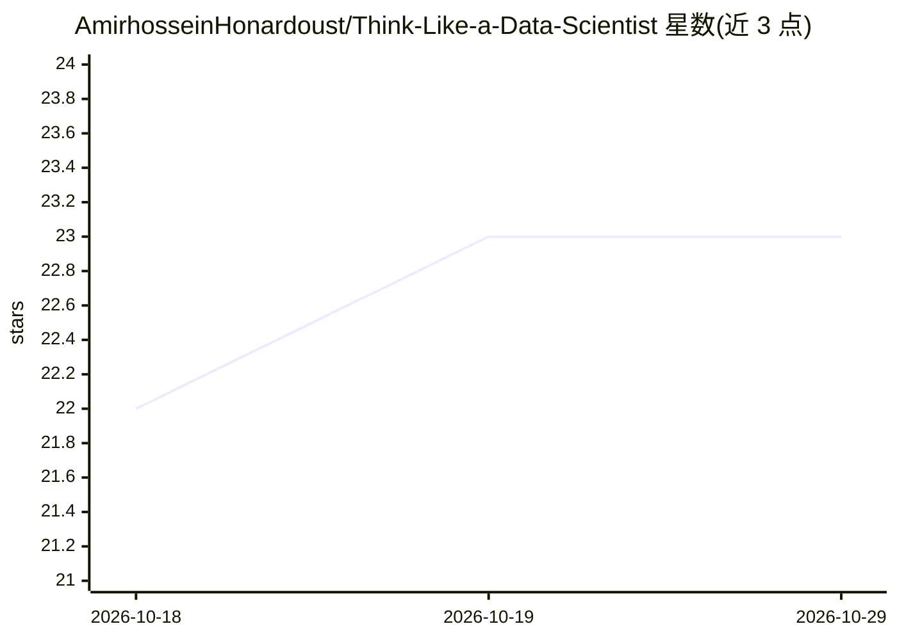

# AmirhosseinHonardoust/Think-Like-a-Data-Scientist

⭐ 23 · MIT · 推送 2025-11-11 · [GitHub](https://github.com/AmirhosseinHonardoust/Think-Like-a-Data-Scientist) · 个人维护

**讲解不写代码如何建立数据科学家思维的文章**

一篇面向数据科学初学者与职场人士的文章，主题是在不写代码的前提下建立数据科学家的思考框架：以好奇心、结构化推理与假设检验为核心，将数据科学生命周期（定义问题、设计数据、清理思路、探索、建模、讲故事）逐步骤展开为无代码的思维练习，并给出日常场景应用、概率化思考与五条思维习惯。全文为 Markdown 文章，不提供代码、安装或运行内容。

## 筛选速览

| 维度 | 判定 | 备注 |
|---|---|---|
| AI 角色 | `ai-knowledge` | 知识聚合/清单类 |
| 许可风险 | `permissive` | MIT |
| 部署形态 | `None` |  |
| 模型依赖 | — | README 未给出锁定关系 |
| 硬件要求 | — | 无带数字的原话,不猜 |
| 安装摩擦 | `low` | 无编译、无系统依赖或容器化 |
| 成熟度 | — | 结构信号不足 |

## 能力要点

- 以六步数据科学生命周期为主线，逐章给出无代码思维练习
- 强调从“证明答案”转向“检验问题”的提问方式
- 提供工作、健康、通勤等日常决策的微数据项目示例
- 总结数据科学家思维五习惯：好奇、怀疑、结构化、可视化、沟通

## 适用场景

- 在学工具和语法之前先建立数据科学的分析直觉
- 把日常决策转化为提出假设并检验的思考练习
- 了解如何向他人讲清数据洞察并推动行动

## 场景标签

`教程课程` · 领域:学习与行业

## 证据(README 行号)

> L1: # How to Think Like a Data Scientist Without Writing Code
> L3: ### *A mental framework for analytical thinking, even when the IDE is closed.*

## 星数曲线

2026-10-18 22 → 2026-10-29 23（+1）

---
*卡片 v1 · prompt 1.4 · 生成 2026-10-27 · 置信度 high · 依据 README sha `3f73baa20f37` · [字段定义](../../DATASET.md)*
