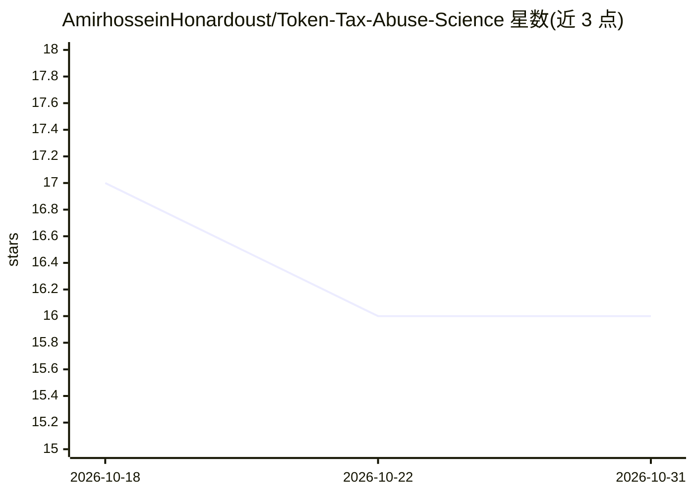

# AmirhosseinHonardoust/Token-Tax-Abuse-Science

⭐ 16 · MIT · 推送 2025-11-22 · [GitHub](https://github.com/AmirhosseinHonardoust/Token-Tax-Abuse-Science) · 个人维护

**面向审计者的 ERC-20 代币税收滥用技术研究文章**

一篇技术深度文章形式的仓库，系统剖析恶意 ERC-20 合约开发者如何将交易费逻辑武器化：覆盖动态税率翻转、隐藏卖出税、白名单绕费、最大交易限制组合、时间/区块触发陷阱、流动性抽干漏斗与反射代币混淆等 7 类滥用模式，并给出 Solidity 层实现细节、从上线到 rug 的时间线、单笔与多笔卖出损失的数学建模，以及 20 项人工审计检查清单。描述中还提出用机器学习与静态分析检测税收滥用，但可见行号内未展示具体 ML 方法实现。面向智能合约审计员与区块链安全研究者，以阅读为主，无可安装运行的代码。

## 筛选速览

| 维度 | 判定 | 备注 |
|---|---|---|
| AI 角色 | `ai-knowledge` | 知识聚合/清单类 |
| 许可风险 | `permissive` | MIT |
| 部署形态 | `None` |  |
| 模型依赖 | — | README 未给出锁定关系 |
| 硬件要求 | — | 无带数字的原话,不猜 |
| 安装摩擦 | `low` | 无编译、无系统依赖或容器化 |
| 成熟度 | — | 结构信号不足 |

## 能力要点

- 7 类代币税收滥用的攻击分类学与 Solidity 实现剖析
- 从发行到 rugpull 的五阶段攻击时间线
- 逐笔与多次卖出场景下的损失数学建模
- 20 项代币费率逻辑人工审计检查清单

## 适用场景

- 审计代币合约时按清单排查费率逻辑后门
- 学习识别蜜罐与 rugpull 的费率滥用模式
- 理解 DEX 交易路径中税收抽取的数学影响

## 场景标签

 · 领域:区块链安全/智能合约审计

## 证据(README 行号)

> L4: > *A full-stack deep dive into how fee logic is implemented, abused, hidden, detected, and modeled with machine lear
> L29: - and how to detect it using machine learning and static analysis.

## 星数曲线

2026-10-18 17 → 2026-10-31 16（-1）

---
*卡片 v1 · prompt 1.4 · 生成 2026-10-30 · 置信度 mid · 依据 README sha `b3af8905d8fa` · [字段定义](../../DATASET.md)*
