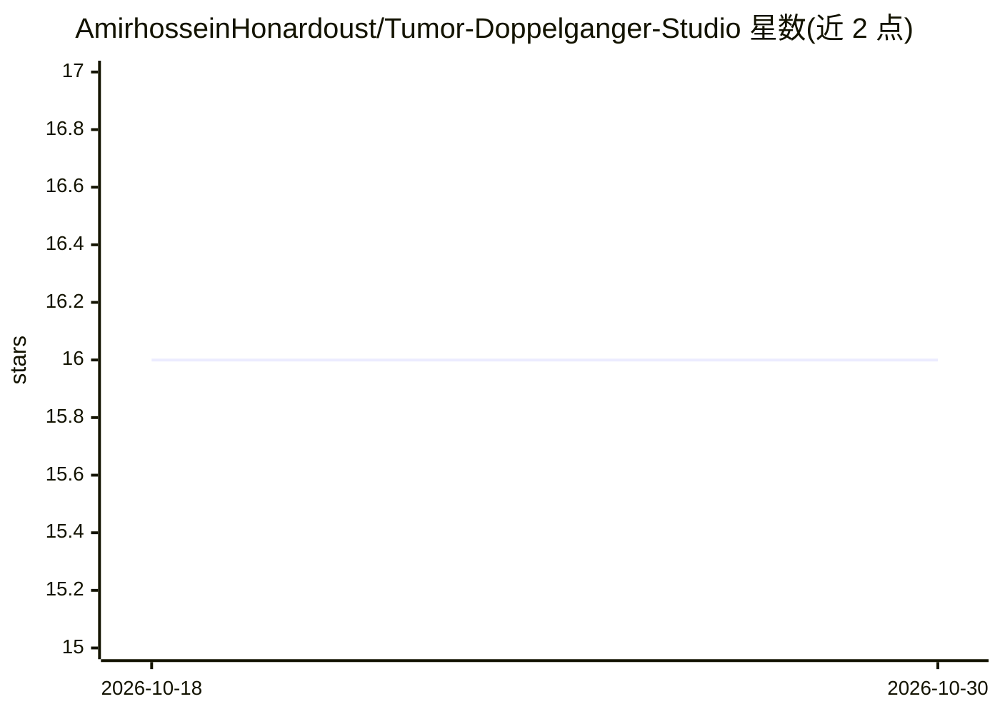

# AmirhosseinHonardoust/Tumor-Doppelganger-Studio

⭐ 16 · Python · MIT · 推送 2025-12-21 · [GitHub](https://github.com/AmirhosseinHonardoust/Tumor-Doppelganger-Studio) · 个人维护

**乳腺癌样本相似性可解释性演示：找最近邻双胞胎并可视化**

基于 Kaggle 公开乳腺癌数据集的 Streamlit 教育演示应用：对选定病例标准化特征后构建 kNN 邻域，展示最相似的良性/恶性"双胞胎"病例、邻域构成、距离衰减曲线、特征差异指纹，以及朝目标类别移动的最小改动反事实几何视图；另带数据集浏览器与 CLI（prepare/index）用于确定性重建数据与索引。README 多处声明仅限教育用途，非医疗器械、不可用于诊断或临床决策。

## 筛选速览

| 维度 | 判定 | 备注 |
|---|---|---|
| AI 角色 | `ai-native` | 本体是模型或模型工具 |
| 许可风险 | `permissive` | MIT |
| 部署形态 | `library` | 以包/库形式分发 |
| 模型依赖 | — | README 未给出锁定关系 |
| 硬件要求 | — | 无带数字的原话,不猜 |
| 安装摩擦 | `low` | 无编译、无系统依赖或容器化 |
| 成熟度 | — | 结构信号不足 |

## 能力要点

- kNN 邻域分析：列出最近良性/恶性相似病例并计算恶性占比
- 特征标准化空间中的差异指纹（difference fingerprint）与雷达图对比
- Minimal-Change Lab 反事实几何视图（非因果声明）
- CLI 支持 cleaned dataset 与 neighbor index 的确定性重建

## 适用场景

- 探索病例在特征空间中的邻域结构是否一致
- 教学演示可解释性概念（邻域证据、边界行为、反事实几何）
- 浏览与核验数据集本身的行、列与类别分布

## 场景标签

`数据分析` · 领域:效率与自动化

## 证据(README 行号)

> L3:  Similarity-first interpretability: find a case’s closest look-alikes (“twins”) and explain why.
> L34: 2. Builds a **k-nearest neighbor (kNN)** neighborhood (the “twins”).
> L8: This project is an **educational visualization** built on a public dataset.

## 星数曲线

2026-10-18 16 → 2026-10-30 16（+0）

---
*卡片 v1 · prompt 1.4 · 生成 2026-10-30 · 置信度 high · 依据 README sha `9fe6d9df1568` · [字段定义](../../DATASET.md)*
