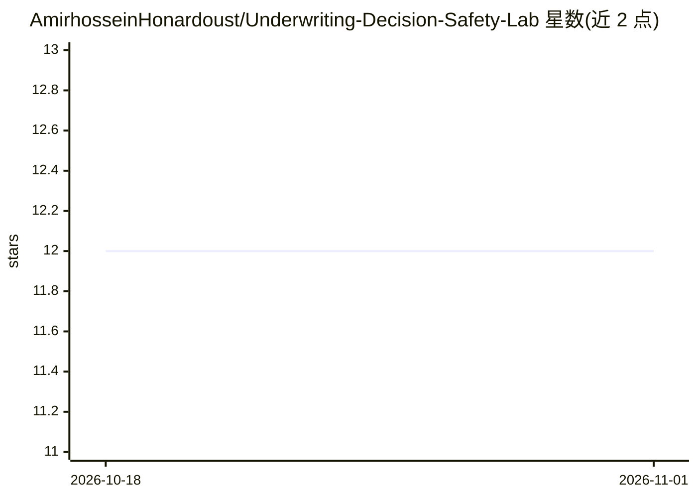

# AmirhosseinHonardoust/Underwriting-Decision-Safety-Lab

⭐ 12 · Python · MIT · 推送 2026-08-17 · [GitHub](https://github.com/AmirhosseinHonardoust/Underwriting-Decision-Safety-Lab) · 个人维护

**贷款审批模型的校准与弃权策略实验工作流（作品集演示）**

基于 scikit-learn 的信贷审批决策安全流程演示项目：读取贷款审批 CSV，校验数据，训练并校准概率模型，计算 Accuracy/F1/AUC/Brier/ECE 等指标，扫描置信度阈值构建覆盖率-质量曲线，输出自动决策与人工复核路由的弃权策略及五种策略变体，并生成切片级安全报告与自包含 model_card.html，附 Streamlit 看板用于报告审阅与分诊。README 明确声明为作品集与研究演示，非生产级信贷决策系统，不含实时监控与再训练。

## 筛选速览

| 维度 | 判定 | 备注 |
|---|---|---|
| AI 角色 | `ai-ecosystem` | LLM/agent 周边工具 |
| 许可风险 | `permissive` | MIT |
| 部署形态 | `library` | 以包/库形式分发 |
| 模型依赖 | — | README 未给出锁定关系 |
| 硬件要求 | — | 无带数字的原话,不猜 |
| 安装摩擦 | `low` | 无编译、无系统依赖或容器化 |
| 成熟度 | — | 结构信号不足 |

## 能力要点

- 概率校准（ECE/Brier）与可靠性图诊断
- 覆盖率-质量曲线与五种弃权策略变体（target_coverage/quality_first 等）
- 切片级安全报告：各申请人组的复核率、错误率、分片 ECE
- Streamlit 看板与单文件自包含 model_card.html、run_manifest.json 运行溯源

## 适用场景

- 演示信贷模型从分数到可辩护决策策略的完整流程
- 学习校准、弃权策略与覆盖率-质量权衡的实践方法
- 用切片诊断检查不同申请人组的复核与错误模式

## 场景标签

`模型评测` `MLOps` · 领域:评测与运维

## 证据(README 行号)

> L11: A production-minded underwriting decision-safety workflow for turning loan-approval model scores into **calibrated 
> L50: - Run automated tests and CI smoke workflows
> L80: - **Unit tests and GitHub Actions CI**

## 星数曲线

2026-10-18 12 → 2026-11-01 12（+0）

---
*卡片 v1 · prompt 1.4 · 生成 2026-11-01 · 置信度 high · 依据 README sha `fb59d3cf5e4c` · [字段定义](../../DATASET.md)*
