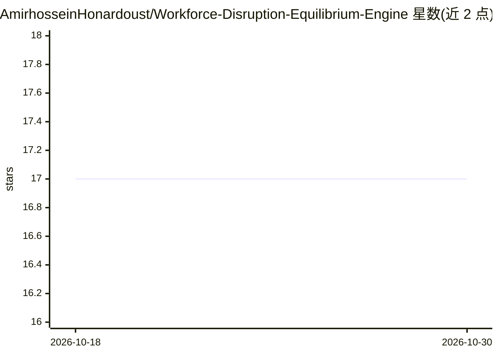

# AmirhosseinHonardoust/Workforce-Disruption-Equilibrium-Engine

⭐ 17 · Python · MIT · 推送 2025-12-13 · [GitHub](https://github.com/AmirhosseinHonardoust/Workforce-Disruption-Equilibrium-Engine) · 个人维护

**AI 劳动力冲击的均衡建模与可视化分析工具**

以 Streamlit 应用形式提供的解释性系统：将职业建模为动态均衡，分解为自动化压力、适应力、技能可迁移性、经济需求与 AI 增强五种结构性力量，输出均衡中心、均衡偏移、韧性带与转型张力等指标；提供情景模拟器（调节 AI 采用速度、监管、教育投入等）与全局张力地图。README 明确声明不做就业流失预测、不支持个人职业决策或自动化雇佣决策。面向战略劳动力规划、政策探索与教育系统设计。

## 筛选速览

| 维度 | 判定 | 备注 |
|---|---|---|
| AI 角色 | `ai-knowledge` | 知识聚合/清单类 |
| 许可风险 | `permissive` | MIT |
| 部署形态 | `None` |  |
| 模型依赖 | — | README 未给出锁定关系 |
| 硬件要求 | — | 无带数字的原话,不猜 |
| 安装摩擦 | `low` | 无编译、无系统依赖或容器化 |
| 成熟度 | — | 结构信号不足 |

## 能力要点

- 五种结构性力量的力分解与均衡中心/偏移/韧性带/张力指标
- 情景模拟器可调节 AI 采用速度、监管严格度、教育投入、企业自动化激励
- 全数据集张力地图以偏移-张力两轴呈现宏观模式
- 支持逐角色的叙事式解读模式

## 适用场景

- 做战略劳动力规划时探索 AI 冲击的情景反事实
- 政策探索中比较监管与教育投入对系统张力的影响
- 理解 AI 驱动的劳动力动态的结构性机制

## 场景标签

`数据分析` · 领域:效率与自动化

## 证据(README 行号)

> L3: The **Workforce Disruption Equilibrium Engine** is an interpretive system designed to help reason about the future o
> L16: It is structured as a **guided walkthrough of the application itself**, with each section anchored to a real screen
> L133: * Automation Pressure

## 星数曲线

2026-10-18 17 → 2026-10-30 17（+0）

---
*卡片 v1 · prompt 1.4 · 生成 2026-10-30 · 置信度 mid · 依据 README sha `5e1c22264beb` · [字段定义](../../DATASET.md)*
