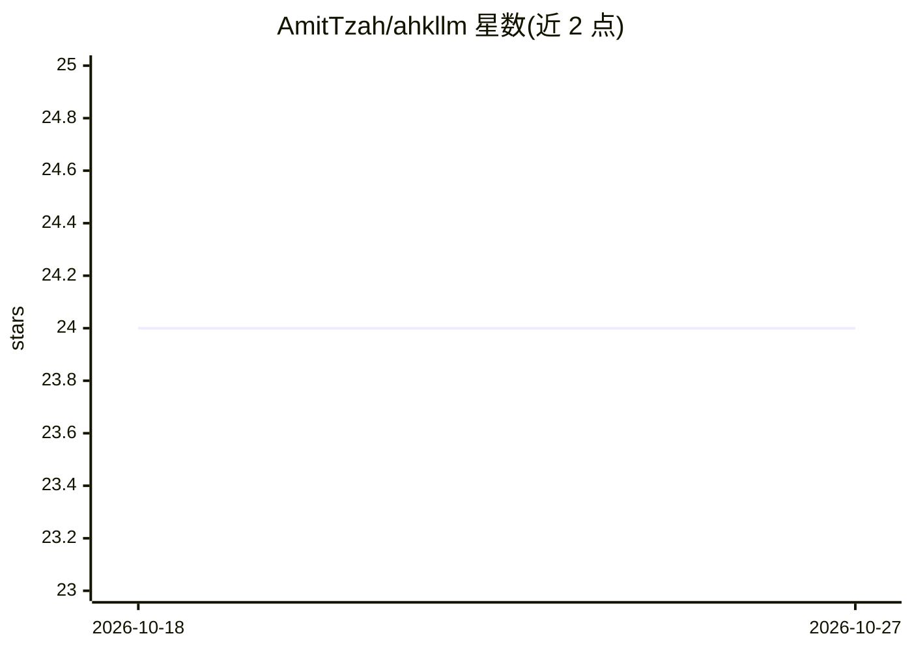

# AmitTzah/ahkllm

⭐ 24 · AutoHotkey · GPL-3.0 · 推送 2026-10-14 · [GitHub](https://github.com/AmitTzah/ahkllm) · 个人维护

**Windows 全局热键 + 完整聊天客户端的 LLM 桌面助手**

基于 AutoHotkey v2 与 WebView2 的 Windows 原生 LLM 助手，分两部分：系统级热键可在任意应用内对选中文本就地改写、摘要、翻译，支持 FIM 续写/填充（默认走 DeepSeek FIM 端点）与截图发送；另一半是完整聊天客户端，含会话分支树、助手、多格式附件、网页搜索、用量面板与 API 日志。支持 DeepSeek、OpenAI、Gemini、OpenRouter、Xiaomi MiMo 及用户自建 OpenAI 兼容端点，也可经 OAuth 使用 ChatGPT 套餐。以便携 ZIP 分发，需另装 AutoHotkey v2 与 WebView2 运行时。

## 筛选速览

| 维度 | 判定 | 备注 |
|---|---|---|
| AI 角色 | `ai-native` | 本体是模型或模型工具 |
| 许可风险 | `viral` | GPL-3.0 |
| 部署形态 | `desktop` | 安装包/桌面程序 |
| 模型依赖 | locked-api |  |
| 硬件要求 | — | 无带数字的原话,不猜 |
| 安装摩擦 | `low` | 无编译、无系统依赖或容器化 |
| 成熟度 | — | 结构信号不足 |

## 能力要点

- 系统级热键在任意应用内就地改写/续写/填充文本（FIM 默认走 DeepSeek 端点）
- WebView2 聊天客户端：会话分支树、助手、附件、网页搜索、用量追踪与 API 日志
- 多提供商接入：DeepSeek/OpenAI/Gemini/OpenRouter/Xiaomi MiMo 及 OpenAI 兼容自建端点
- ChatGPT 套餐 OAuth 与 Codex CLI 后端，凭据经 Windows DPAPI 保护

## 适用场景

- 在写作或写代码时用热键就地改写、续写、填充选中文本
- 把截图作为图像上下文发给模型解释屏幕内容
- 用带分支树的聊天客户端管理与派生多个对话
- 不想付 API 费用时经 ChatGPT 套餐 OAuth 使用

## 场景标签

`AI 助手` `聊天机器人` · 领域:对话与助手

## 证据(README 行号)

> L9: AhkLLM is a Windows LLM assistant built around two things: system-wide hotkeys and a full chat application.
> L11: You can select text in another application and rewrite it in place, summarize it, translate it, send it into a chat
> L68: - DeepSeek, OpenAI, Gemini, OpenRouter, Xiaomi MiMo, built-in Codex CLI and ChatGPT-plan OAuth backends, and user-a

## 星数曲线

2026-10-18 24 → 2026-10-27 24（+0）

---
*卡片 v1 · prompt 1.4 · 生成 2026-10-27 · 置信度 high · 依据 README sha `422c42ab0cc5` · [字段定义](../../DATASET.md)*
