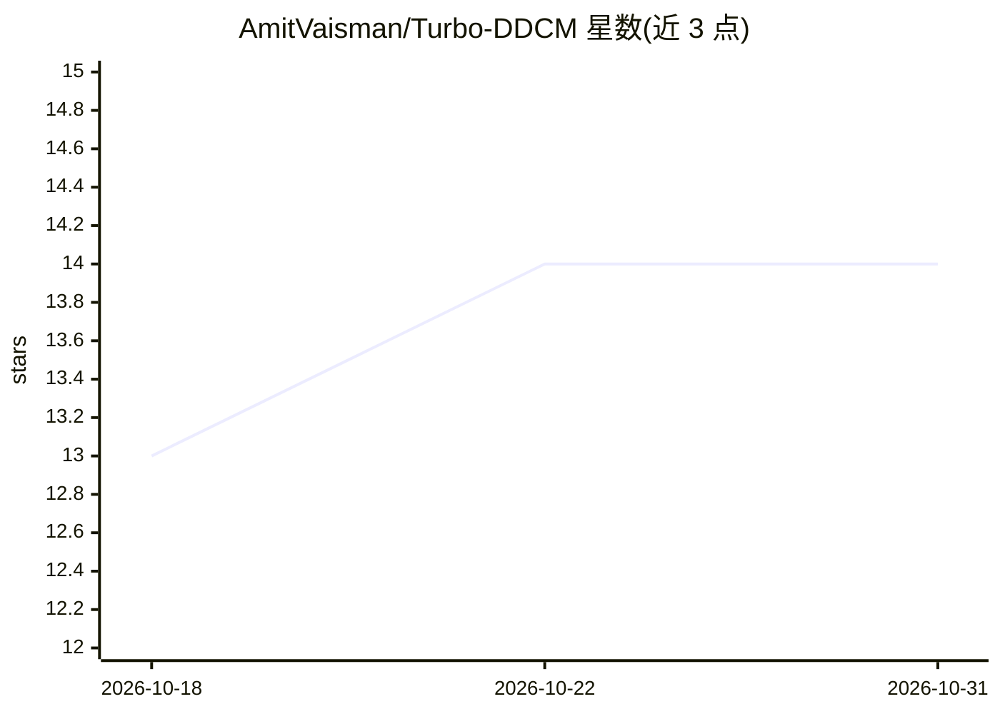

# AmitVaisman/Turbo-DDCM

⭐ 14 · Python · MIT · 推送 2026-04-20 · [GitHub](https://github.com/AmitVaisman/Turbo-DDCM) · [官网](https://amitvaisman.github.io/turbo_ddcm/) · 组织维护

**基于扩散模型的零样本图像压缩论文官方代码（ICLR 2026）**

Turbo-DDCM 论文的官方 PyTorch 实现，用扩散模型对图像做零样本有损压缩：提供 compress.py / decompress.py / roundtrip.py 三个脚本，支持 512² 至 1024² 分辨率图像，压缩时保存二进制文件与配置 JSON，可记录压缩/解压运行时。支持 priority-aware 压缩（--weights_dir 指定逐像素优先级张量），可调 M（每扩散步码本原子数）与 K（默认 16,384，面向 512² 图像）。作者来自 Technion 与 Flatiron 研究所。

## 筛选速览

| 维度 | 判定 | 备注 |
|---|---|---|
| AI 角色 | `ai-native` | 本体是模型或模型工具 |
| 许可风险 | `permissive` | MIT |
| 部署形态 | `library` | 以包/库形式分发 |
| 模型依赖 | — | README 未给出锁定关系 |
| 硬件要求 | — | 无带数字的原话,不猜 |
| 安装摩擦 | `low` | 无编译、无系统依赖或容器化 |
| 成熟度 | — | 结构信号不足 |

## 能力要点

- compress/decompress/roundtrip 三个命令行脚本
- 支持 512²–1024² 分辨率图像压缩
- priority-aware 压缩：逐像素优先级张量控制重建质量分布
- 记录压缩/解压/往返运行时

## 适用场景

- 研究扩散模型图像压缩方法的复现与实验
- 对图像数据集做可调参数的有损压缩解压往返测试
- 探索按区域重要性分配码率的压缩实验

## 场景标签

`图像视频处理` · 领域:感知与多模态

## 证据(README 行号)

> L6: # Turbo-DDCM: Fast and Flexible Zero-shot Diffusion-based Image Compression [ICLR 2026]
> L29: Our code supports compressing images with resolutions ranging from $512^{2}$ to $1024^{2}$.

## 星数曲线

2026-10-18 13 → 2026-10-31 14（+1）

---
*卡片 v1 · prompt 1.4 · 生成 2026-10-31 · 置信度 high · 依据 README sha `4598cd4ee83e` · [字段定义](../../DATASET.md)*
