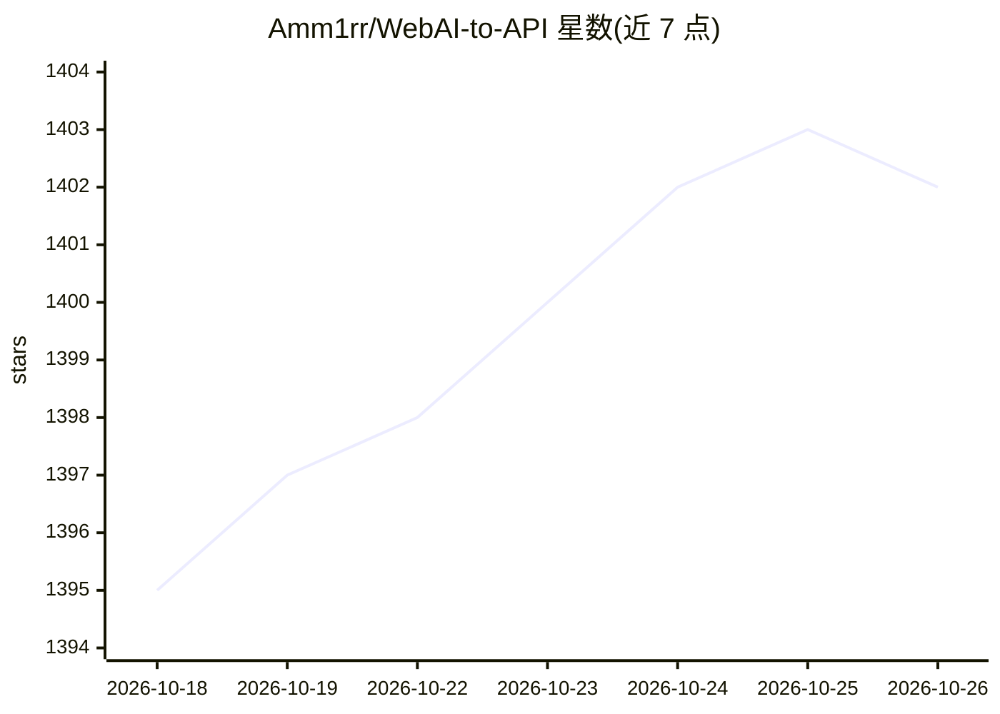

# Amm1rr/WebAI-to-API

⭐ 1,402 · Python · MIT · 推送 2026-10-19 · [GitHub](https://github.com/Amm1rr/WebAI-to-API) · 个人维护

**将浏览器版 Gemini 封装为 OpenAI 兼容 API 的服务端**

用 Python/FastAPI 编写的服务端，通过 WebAPI 或 Playwright 浏览器运行时访问 Google Gemini 网页版，对外暴露 OpenAI 兼容的 /v1/chat/completions 接口，支持 SSE 流式输出、对话延续、无状态（客户端持有历史）端点与工具调用。提供 Dashboard、Swagger UI、健康检查与运行时诊断端点，支持 Docker Compose 部署与各平台安装/更新脚本。需浏览器登录或 Cookie 认证；不提供调用方 API 鉴权，默认绑定 localhost。当前可用 Provider 为 Gemini。

## 筛选速览

| 维度 | 判定 | 备注 |
|---|---|---|
| AI 角色 | `ai-ecosystem` | LLM/agent 周边工具 |
| 许可风险 | `permissive` | MIT |
| 部署形态 | `self-host` | docker 或自建部署 |
| 模型依赖 | — | README 未给出锁定关系 |
| 硬件要求 | — | 无带数字的原话,不猜 |
| 安装摩擦 | `low` | 无编译、无系统依赖或容器化 |
| 成熟度 | — | 结构信号不足 |

## 能力要点

- OpenAI 兼容 /v1/chat/completions，含流式 SSE 与工具调用
- Gemini 双后端：WebAPI 与 Playwright 浏览器运行时，模型前缀路由
- 无状态端点供客户端持有历史的 Agent（如 Hermes）使用
- 提供 Dashboard、Swagger UI、Docker 部署与更新脚本

## 适用场景

- 把网页版 Gemini 接入支持 OpenAI API 格式的客户端或应用
- 为 Agent 框架提供 Gemini 无状态对话后端
- 通过 Dashboard 管理认证、模型与对话

## 场景标签

`模型网关` · 领域:Agent 开发

## 证据(README 行号)

> L6: **WebAI-to-API** is a browser-native AI runtime that exposes browser-based AI services through OpenAI-compatible API
> L10: * OpenAI-compatible `/v1/chat/completions` API

## 星数曲线

2026-10-18 1,395 → 2026-10-26 1,402（+7）

---
*卡片 v1 · prompt 1.4 · 生成 2026-10-21 · 置信度 high · 依据 README sha `fc366782e2e8` · [字段定义](../../DATASET.md)*
