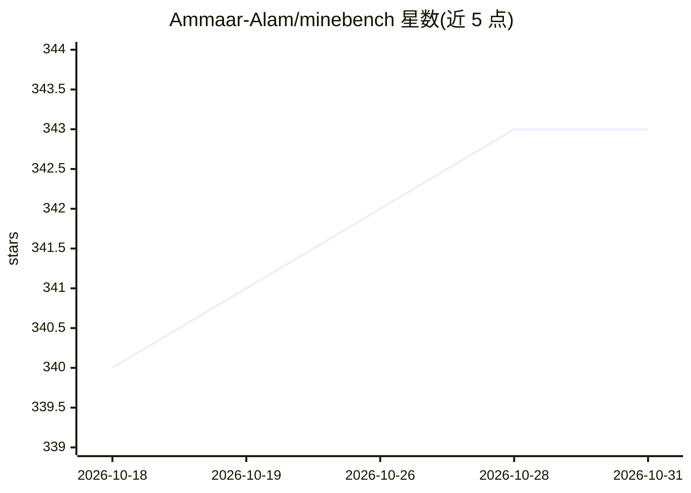

# Ammaar-Alam/minebench

⭐ 343 · TypeScript · MIT · 推送 2026-10-30 · [GitHub](https://github.com/Ammaar-Alam/minebench) · [官网](https://minebench.ai) · 个人维护

**Minecraft 体素构建风格的 AI 空间推理评测竞技场**

通过 Minecraft 风格体素构建评测 AI 模型的空间推理：给定自然语言提示，模型以 JSON 输出 3D 坐标或在工具模式下调用 voxel.exec 原语（block/box/line）生成大型构建；系统可视化输出并用全球 Bradley-Terry 模型基于盲测投票排名，附不确定性区间。含 Arena 对比、Sandbox 生成/导入、Gallery、排行榜与 GLB/STL/vox/schem 导出。基准模型来自 OpenAI、Anthropic、DeepSeek、Qwen 等及 OpenRouter 可用模型。本地运行需 Node.js 18+、pnpm 与 Docker；作者声明其为 Alpha 阶段，且无客观正确答案，性质类似 LMSYS Chatbot Arena。

## 筛选速览

| 维度 | 判定 | 备注 |
|---|---|---|
| AI 角色 | `ai-ecosystem` | LLM/agent 周边工具 |
| 许可风险 | `permissive` | MIT |
| 部署形态 | `library` | 以包/库形式分发 |
| 模型依赖 | — | README 未给出锁定关系 |
| 硬件要求 | — | 无带数字的原话,不猜 |
| 安装摩擦 | `low` | 无编译、无系统依赖或容器化 |
| 成熟度 | `idea` | |

## 能力要点

- 自然语言提示生成 3D 体素构建，支持 voxel.exec 工具调用模式
- 盲测头对头投票 + Bradley-Terry 全局排名（含不确定性区间）
- Sandbox 可比较/生成构建并导入任意模型输出
- 构建可导出为 GLB、STL、MagicaVoxel .vox、WorldEdit .schem

## 适用场景

- 对比不同 LLM 的 3D 空间推理能力
- 以可视化方式直观查看各模型的构建输出
- AI 实验室私下单模型 checkpoint 做 A/B 测试

## 场景标签

`模型评测` · 领域:评测与运维

## 证据(README 行号)

> L24: **A benchmark for evaluating AI spatial reasoning through Minecraft-style voxel construction.**
> L26: Models are given a natural-language prompt and must produce raw 3D coordinates as JSON. In tool mode, models call `

## 星数曲线

2026-10-18 340 → 2026-10-31 343（+3）

---
*卡片 v1 · prompt 1.4 · 生成 2026-10-21 · 置信度 high · 依据 README sha `ff4ca7f40fae` · [字段定义](../../DATASET.md)*
