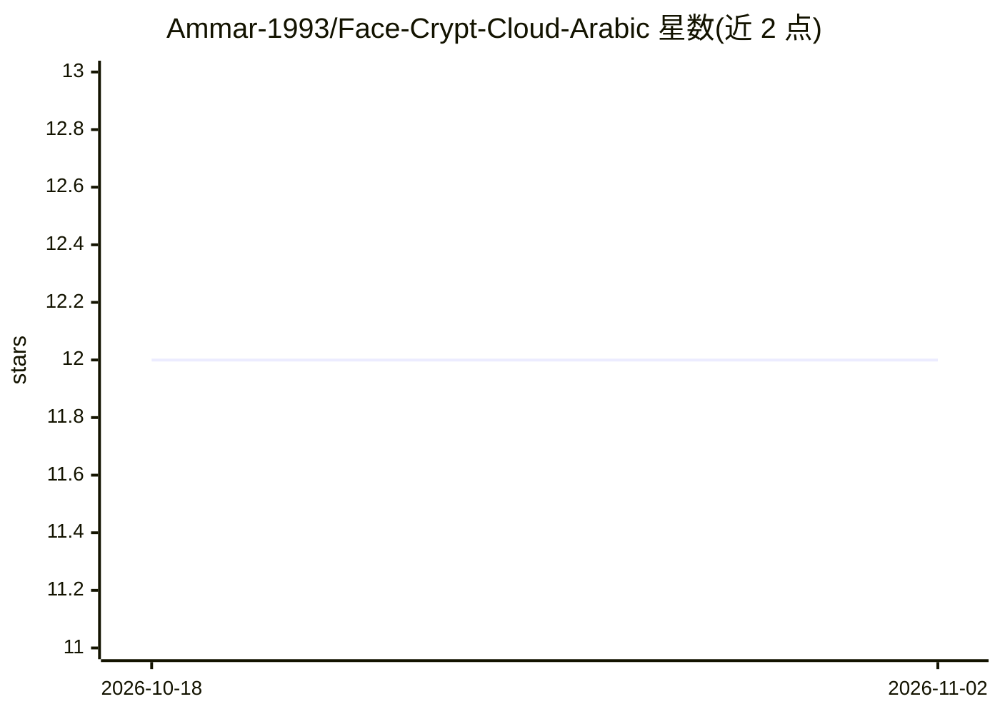

# Ammar-1993/Face-Crypt-Cloud-Arabic

⭐ 12 · Python · MIT · 推送 2026-10-18 · [GitHub](https://github.com/Ammar-1993/Face-Crypt-Cloud-Arabic) · [官网](https://face-crypt-cloud-184918603595.us-central1.run.app) · 个人维护

**基于人脸识别的无密码云端身份认证系统（阿拉伯语/英语）**

高级工程毕业设计项目：以 Flask 为后端、Firebase（Firestore/Storage）为云端的生物识别认证系统。通过摄像头采集人脸，用 dlib/face_recognition 提取 128 维编码，经 Fernet（AES-128 + HMAC-SHA256）加密后存储；登录匹配仅在服务器内存中完成，不存储任何人脸图像。含多层活体检测（Laplacian 模糊分析、MediaPipe 浏览器端几何挑战、MiniFASNetV2 ONNX 反欺诈）、速率限制与账户锁定、防枚举、审计日志、WebAuthn passkey 及 AR/EN 双语界面。提供 Docker 与本地 venv 两种部署方式，34 个 pytest 测试。限制：明确声明不防御实时 deepfake 操控攻击。

## 筛选速览

| 维度 | 判定 | 备注 |
|---|---|---|
| AI 角色 | `ai-native` | 本体是模型或模型工具 |
| 许可风险 | `permissive` | MIT |
| 部署形态 | `self-host` | docker 或自建部署 |
| 模型依赖 | — | README 未给出锁定关系 |
| 硬件要求 | — | 无带数字的原话,不猜 |
| 安装摩擦 | `low` | 无编译、无系统依赖或容器化 |
| 成熟度 | — | 结构信号不足 |

## 能力要点

- dlib 人脸编码 + Fernet 加密存储，零图像持久化，匹配仅在内存中进行
- 三层活体检测：Laplacian 静态照片检测、MediaPipe 活动挑战、MiniFASNetV2 AI 反欺诈
- 速率限制、3 次失败软封锁/5 次永久封锁、防枚举（统一 403 响应）与防时序攻击
- 管理后台：实时用户管理、安全统计、动态匹配阈值与审计日志分页

## 适用场景

- 用面部识别替代密码完成网站登录认证
- 为需要生物识别登录的应用提供带活体检测的参考实现
- 需要完整审计追踪与账户封锁策略的认证场景学习/演示

## 场景标签

`人脸识别` · 领域:感知与多模态

## 证据(README 行号)

> L20: The system works by capturing a live image of the user via webcam, extracting precise biometric face encodings usin
> L26: * 🕵️ **Multi-Layer Liveness Detection:** Detects static printed photos via Laplacian blur analysis, performs real-t
> L79: |**AI & Image Processing**|`face_recognition`, `dlib`, `opencv-python-headless`, `onnxruntime` (MiniFASNetV2 — Apac

## 星数曲线

2026-10-18 12 → 2026-11-02 12（+0）

---
*卡片 v1 · prompt 1.4 · 生成 2026-11-01 · 置信度 high · 依据 README sha `0b9e4ee89769` · [字段定义](../../DATASET.md)*
